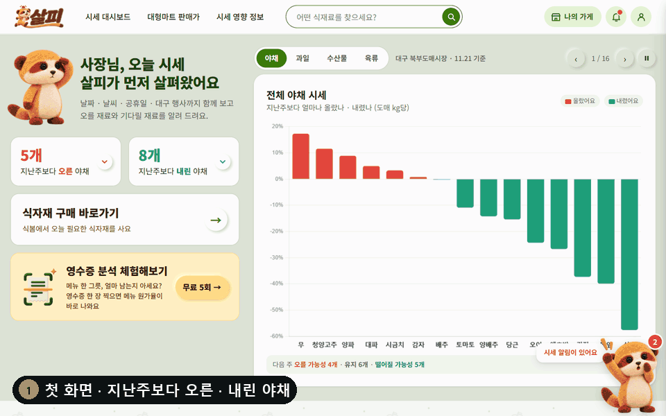

# 🧺 살피 — 대구 한식당 사장님의 재료값 · 원가 관리 AI

> 영수증 사진 한 장 → 메뉴별 원가율 → 40%를 넘으면 다음에 할 일 3가지

11/23 배포 사이트 화면 · 시연용 가상 가게 자료 · 영수증 읽기와 챗봇 답은 실제 AI 결과

- **배포 화면**: https://jangbaguni-ten.vercel.app/
- **관제 화면**: https://jangbaguni-ten.vercel.app/static/control.html
- **PPT (캔바)**: -

---

## 살피는 무엇을 하나요

| | |
|---|---|
| **누구를 위해** | 대구 한식음식점 사장님 (1~2인 운영, 재료를 직접 삼) |
| **무엇이 문제** | "메뉴 하나 팔면 얼마 남는지" 모른 채 오르는 재료값을 버팀 — 사장님 글(VOC) 333개 중 원가 고민이 59% |
| **살피의 약속** | 영수증 사진 한 장으로 메뉴별 원가율을 보여 주고, 40%를 넘으면 **가격 조정 · 대체 재료 · 다른 메뉴** 3가지를 제안 |
| **원칙** | **AI는 읽기 · 나누기 · 말하기만, 숫자는 계산과 학습 모델만** — AI가 숫자를 지어내지 않음 |

**사용 흐름**

영수증 사진 → 품목 · 양 · 금액 확인 → 메뉴별 원가율 → (40% 이상) 3가지 제안 → 다음 7일 시세 · 더 싼 판매처 → 아침 알림 (카카오톡 · 앱)

---

## 🤖 AI 기능

| 기능 | 무엇을 하나 | 어떻게 |
|---|---|---|
| 🧾 **영수증 읽기** | 영수증 사진에서 품목 · 수량 · 단위 · 금액을 읽음 | 제미나이가 읽고 → 사장님이 확인 · 수정. 고친 "영수증 이름 → 재료" 짝은 기억 |
| 📈 **7일 시세 예측** | 재료가 7일 뒤 오를지 · 비슷할지 · 내릴지 + 가격 범위 + 이유 | 직접 구현한 그래디언트 부스팅. 도매 경락가 · 반입량 · 날씨 · 공휴일 · 행사로 학습 |
| 🔁 **매일 스스로 학습** | 매일 새벽 6시 다시 학습하고, 고정 공식보다 나을 때만 모델 교체 | GitHub Actions. 정반대로 틀린 비율 야채 28.2 → 22.8% · 과일 21.8 → 20.5% (11/17 모델) |
| ✅ **실전 채점** | 화면에 나간 예측을 저장했다가 7일 뒤 실제 가격과 비교 | 방향 적중 · 범위 적중 · 정반대 비율 |
| 🍲 **내일 판매량 · 발주량** | 메뉴별 내일 그릇 수 → 필요한 재료 − 재고 = 발주량 | 판매량 학습 모델. **가상 가게 1년 치 데이터**로 학습 (실제 가게 데이터 없음) |
| 💬 **살피 챗봇** | 사장님 질문에 근거 숫자와 함께 답 | 🧭 안내가 질문을 나눠 → 📈 시세 · 💰 원가 · 마진 · 📦 내일 준비 담당이 도구로 숫자를 가져와 살피 말투로 설명 |
| 🗺️ **고객 묶음 찾기** | 대구 음식점 3만 곳을 묶어 먼저 노릴 고객을 정함 | k-평균 군집 (비지도 학습) → "독립 한식" 45% |

**AI 숫자를 쓰는 계산 기능**

- **메뉴별 원가율 · 3가지 제안**: 레시피 양 × 재료 단가 ÷ 판매가. 다음 주 예상 시세까지 반영
- **싸게 · 비싸게 판정**: 영수증 단가를 우리 가게 평소 단가 · 대구 시세와 비교
- **더 싼 판매처**: 판매처 상품을 kg당 가격으로 바꿔 산 값보다 싼 곳만
- **단위 환산**: "500g×2" · "1포기" 같은 글자를 kg · L · 모 · 개로

---

## 쓰는 자료

aT 대구 북부도매시장 경락가 · 반입량, 가락시장, KAMIS 도 · 소매가, 축산물품질평가원, 기상청 (관측 · 단기 · 중기예보), 특일 · 관광공사 행사, 한국소비자원 참가격, 식봄 상품, 대구시 음식점 등록현황

## 폴더

| 폴더 | 내용 |
|---|---|
| [salpi_agent/](salpi_agent/) | 서버 · 화면 · AI (실행 방법은 [salpi_agent/README.md](salpi_agent/README.md)) |
| [supabase/](supabase/) | 데이터베이스 표 |
| [data/](data/) | 받은 자료 · 가상 가게 데이터 |
| [plan/](plan/) | 기획 · 예측 · 발표 문서 ([기능 명세](plan/spec.md)) |
| [research/](research/) | 업종 · 기업 · 장소 리서치 |
| [brand/](brand/) | 로고 · 캐릭터 · 살피 말투 |

## 작업 규칙: [git-convention.md](git-convention.md)

## 일정 · 할 일: Issue에서 관리
