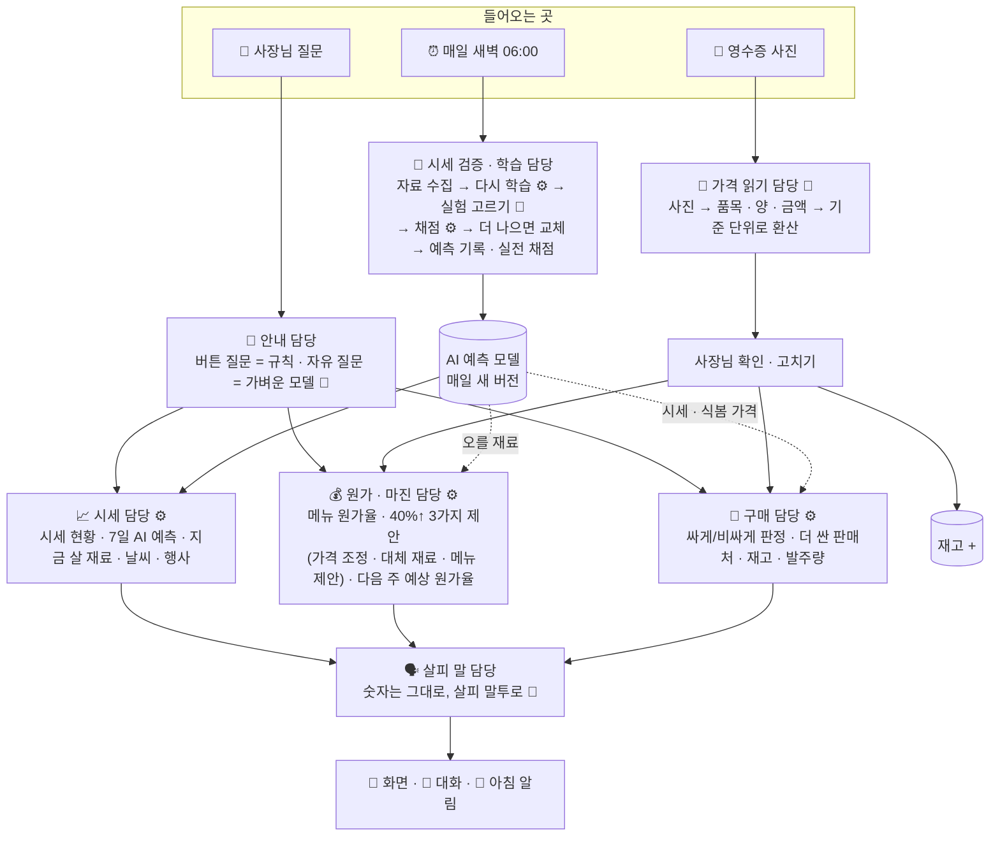

# 최종 발표까지 계획 (11/16 ~ 11/27 완성, 12/4 발표)

> 무엇: 12/4 최종 발표를 위해 **11/27(금)까지 끝낼 일 전부**와 매일 일정표(09–18시, 점심 13–14시 제외), 받아야 할 자료, 정해야 할 것, 논리가 약한 곳
> 앞 문서: [11/13 피드백 할 일](presentation/1113_feedback_todo.md) · [스스로 배우는 시세 예측](forecast/1116_self_learning_forecast.md) · [AI 에이전트 파이프라인 (11/12)](bm/1112_agent_pipeline.md) · [BM](bm/1112_bm_canvas.md) · [시장 규모](bm/1113_시장규모시트.md) · [경쟁사 비교](bm/1113_경쟁사비교.md)
> 표시: ✅ 끝 · 🟡 일부 · ⬜ 안 함 · 👤 사람이 해야 함 (키 · 신청 · 인터뷰 · PPT)

---

## 0. 한눈에

| 날짜 | 마감 |
|---|---|
| **11/18 (수)** | 정할 것 3가지 확정: 구독료 · 단위 기준 · 판매처 연결 방향 (2절) |
| **11/19 (목)** | PPT에 넣을 숫자 · 그림 넘기기 (AI 파이프라인 새 그림, 모델 성적, 구독료, 업체 선정 이유) |
| **11/20 (금)** | PPT 정리 (팀) · 기획서 초안 |
| **11/26 (목)** | 제안서 · 기획서 최종 |
| **11/27 (금)** | **기능 · 검증 · 문서 모두 끝** (이후는 버그 수정 · 리허설만) |
| 11/30 ~ 12/3 | 구조 변경 금지. 실전 채점 2주 결과 넣기 · 시연 녹화 · 리허설 |
| **12/4 (금)** | 최종 발표 |

**가장 중요한 세 줄**
1. **AI 학습 모델(매일 새벽 스스로 다시 배움)을 전 품목으로** 넓히고, 화면에 성적을 보여 준다
2. **검증을 숫자로**: 과거 1년 시험 + 실전 채점 + 식봄 시차 + 영수증 OCR 정확도 + 레시피 원가율
3. **서브에이전트를 실제로 나눈다** (지금은 한 덩어리) → 발표의 AI 파이프라인 그림과 코드가 같아야 함

---

## 1. 질문에 대한 답

### 1-1. 지금 학습 모델은 부스팅인가? → 네

- **그래디언트 부스팅** (결정 나무를 수백 개 차례로 쌓고, 뒤 나무가 앞 나무의 오차를 고치는 방식). LightGBM 방식을 외부 라이브러리 없이 직접 구현 (`salpi_agent/price/gbdt.py`)
- 왜 부스팅: ① 표 모양 자료(가격 · 반입량 · 날씨 · 날짜)에 가장 강한 방식 ② 자료 4만 건 수준에 알맞음 (딥러닝은 자료가 더 많아야 함) ③ **요인별로 몇 % 반영했는지 설명 가능** → 화면 "이렇게 본 이유" ④ 학습이 1분이라 **매일 다시 배울 수 있음**
- 비교한 방법: 고정 공식 · 절대오차 회귀 · 부스팅 → 부스팅이 가장 좋아 채택 ([부스팅 비교](forecast/1112_boosting_compare.md))
- 매일 새벽: 다시 학습 → AI(제미나이)가 실험 2개 고름 → 같은 시험으로 채점 → **정반대 0.3%p↓ + 평균 오차 같거나↓일 때만 스스로 교체**

### 1-2. 재고 관리가 되나? → 보기만 되고, 입력 · 수정은 안 됨

| 있는 것 ✅ | 없는 것 ⬜ (할 일에 추가) |
|---|---|
| Supabase `inventory` 표 (재료 · 남은 양 · 다음 입고일) | 사장님이 재고를 **입력 · 고치는 화면과 API** |
| "내일 준비" 발주량 = 입고까지 필요량 + 여유 10% − 재고 (`demand.py`) | 영수증을 저장하면 **산 만큼 재고가 자동으로 늘기** |
| 화면에 재고 · "이번엔 안 사도 돼요" 표시 | 판매(예측 그릇 수 × 레시피)만큼 **자동으로 줄기** · 재고 부족 알림 |

- 지금 재고 숫자는 시연 데이터(seed)뿐이라, 발표에서 "재고를 반영한 발주"라고 말하려면 **입력 · 수정 화면이 꼭 필요**

### 1-3. kg · g · 개 단위 → 기준 정해야 함 (2-2절)

### 1-4. 공식 → 학습 방식으로 (5절)

---

## 2. 정해야 할 것 (11/18까지)

### 2-1. 구독료 → **추천: 무료 + 월 19,900원 한 가지**

| 플랜 | 가격 | 들어가는 것 |
|---|---|---|
| 무료 | 0원 | 시세 대시보드 · 7일 AI 예측 · 챗봇 시세 질문 · **영수증 분석 5회 체험** |
| 살피 플러스 | **월 19,900원** (연 결제 할인은 선택) | 영수증 분석 무제한 · 메뉴별 원가율 · 원가율 40% 넘을 때 3가지 제안 · 싸게/비싸게 판정 · 재고 · 발주 · 아침 알림 |

**근거**
- 아끼는 돈이 구독료의 **약 4.4배** (연 식재료비 약 1억 389만 원 × 1% = 104만 원 vs 연 238,800원) — [시장 규모 시트](bm/1113_시장규모시트.md)
- 같은 값의 경쟁 앱 **키친코스트 Pro 19,900원은 레시피 원가만** (영수증 OCR · 시세 · 예측 없음) → 같은 가격에 더 많은 것
- 9,900원이면 해지율을 3% 안팎으로 지켜야 버팀 (시트 민감도 표). 29,900원은 영업이익률이 낮은 작은 식당에 부담
- 5회 무료는 "영수증 + 판매량을 같이 넣어야 원가율 · 마진을 체감"하기 때문 (팀 의견 그대로)

**약한 곳**: 사장님 지불 의향을 직접 물어본 적이 없음 → 👤 사장님 5명에게 "얼마면 비싸다 · 싸다" 4문항만 물어보면 근거가 생김 (7절 자료)

### 2-2. 단위 기준 → **"품목마다 기준 단위 하나, 비교는 기준 단위당 가격으로만"** (✅ 11/17 확정)

| 규칙 | 내용 |
|---|---|
| 기준 단위 | 무게로 사고파는 것은 **kg** (야채 · 과일 · 고기 · 수산물 · 장류 · 가루). 액체는 **L** (간장 · 참기름 · 식용유 · 액젓 · 식초 등, mL는 ÷1,000). 무게로 못 재는 것만 **모 · 개** (두부 = 모, 계란 = 개, 라면사리 = 개). g는 kg로 (÷1,000) |
| 레시피 적는 법 | kg 재료는 g, L 재료는 mL, 개 · 모 재료는 그대로 적고 계산할 때 기준 단위로 바꿈 (계란 1판(30구) = 30개로 환산) |
| kg ↔ L | 섞어서 비교하지 않음. "1kg 짜리 액젓"처럼 무게로 파는 액체는 비중 근거가 약해 **L로 안 바꾸고 비교에서 뺌** (11/17 결정) |
| 판매처별 처리 | 도매 경락가: 이미 kg / 식봄: 규격 글자에서 kg 읽기 (지금 됨) / 대형마트 · KAMIS 소매: 포기 · 개 · 봉이 많음 → **품목별 표준 무게표로 환산** / 쿠팡 · 네이버: 상품명에서 무게 · 개수 읽기 / 영수증: AI가 기준 단위로 바꾸고 사장님이 확인 (지금 됨) |
| 환산표 | 배추 1포기 · 무 1개 · 양배추 1통 · 대파 1단 · 수박 1통 등 **"1개 = 몇 kg" 표**를 출처와 함께 만듦 (7절 자료) |
| 화면 표시 | 환산이 들어간 값은 "**약** ○○원/kg (1포기 ≈ ○kg로 환산)"처럼 표시 |
| 판정 규칙 | 환산이 들어간 비교는 차이가 10% 안쪽이면 "비슷해요"로 (환산 오차 때문에 억지 판정 안 함). 단위를 못 읽은 상품은 비교에서 뺌 |

**환산표 v2 (11/17, 코드: `salpi_agent/price/units.py`)** — 기본 규칙: [농산물 표준규격](https://www.law.go.kr/LSW//flDownload.do?flSeq=135060175&flNm=%5B%EB%B3%84%EC%B2%A8%5D+%EB%86%8D%EC%82%B0%EB%AC%BC+%ED%91%9C%EC%A4%80%EA%B7%9C%EA%B2%A9&bylClsCd=200207)(국립농산물품질관리원 고시) 크기 구분 **L 구간 가운데값**. KAMIS 조사 규격에 무게가 있으면 그 값 우선

| 품목 | KAMIS 소매 조사 단위 | 1개 무게 | 근거 | 확인 |
|---|---|---|---|---|
| 배추 | 1포기 | 3.3kg | KAMIS 중도매 규격 "그물망 3포기 10kg" (표준규격 일반배추 L 3~4kg 안) | ✅ |
| 양배추 | 1포기 | 2.5kg | 표준규격 L 2~3kg | ✅ |
| 무 | 1개 | 2.5kg | 표준규격 L 2~3kg | ✅ |
| 사과 | 10개 | 275g | 표준규격 L 250~300g | ✅ |
| 배 | 10개 | 550g | 표준규격 L 500~600g | ✅ |
| 단감 | 5개 | 225g | 표준규격 L 200~250g | ✅ |
| 감귤 | 10개 | 95g | 표준규격 온주밀감 M 83~106g (KAMIS가 M과 조사) | ✅ |
| 수박 | 1개 | 7kg | 11월 대구 가격 역산: 북부도매 경락 1,855원/kg, 중도매 상품 1통 약 14,700원 → 8.5kg면 중도매가 경락보다 싸짐(1,729원/kg). 중도매 웃돈 10~15% 가정 시 약 7kg (표준규격 L 8~9kg는 제철 기준) | ✅ 11/17 |
| 애호박 | 1개 | 250g | 식봄 "애호박(상, 1입)" 규격 0.25kg (v1 270g에서 바꿈) | ✅ |
| 오이 | 10개 | 200g | 식봄 "취청오이(상 5입 1Kg)" (v1 150g에서 바꿈 — 소매가 도매의 3.7배로 높게 나왔던 이유) | ✅ |
| 가지 | 3개 | 150g | 표준규격에 무게 없음, 요리 계량 자료 → 화면에 **100g당 값**도 같이 표시 | ✅ 11/17 (약) |
| 레몬 | 10개 | 120g | 표준규격 없음, 자료마다 100~150g → 화면에 **100g당 값**도 같이 표시 | ✅ 11/17 (약) |
| 대파 | 1단 | 1kg | 식봄 "흙대파(1단 1Kg)" · "10단/망 10kg" | ✅ |
| 시금치 | 1단 | 250g | 식봄 "시금치 1단-약250g" | ✅ |
| 깻잎 | 1속 | 20g | 식봄 "깻잎 10속 200g" | ✅ |
| 양파 · 당근 · 감자 · 토마토 | 1개 | 220g · 250g · 150g · 200g | 식봄 규격의 개당 무게 범위 (예: 양파 "180~230g/개") | ✅ (KAMIS는 kg로 와서 판매처 · 영수증에만 씀) |
| 액체 비중 | — | 안 씀 | 근거가 약해 kg로 파는 액체는 비교에서 뺌 (대부분 L · mL로 팜) | ✅ 11/17 |

### 2-3. 판매처 연결 · 왜 CJ프레시웨이 · 왜 식봄

**왜 CJ프레시웨이였나 (기업 트랙)**
- 식자재 B2B 플랫폼은 많음 (푸디스트 · 배민상회 등). **타깃 고객이 다르거나 AI 관련 기사가 없어서 제외** — 예: 푸디스트는 AI가 급식(단체급식) 쪽에 한정 ([업체 선정](../research/industry_food/업체선정.md))
- CJ프레시웨이는 **영남권(경상권) 배송을 넓히는 중** → 대구 사장님 대상인 살피와 지역이 맞음
- 식봄 운영사(마켓보로) 최대주주 → 사장님 구매 창구(식봄)와 이어짐. 식봄은 AI 가격 비교 · AI 발주를 하고 있어 "AI 방향"이 분명

**왜 식봄이었나**
- 사장님이 실제로 쓰는 온라인 식자재 장터 (회원 22만 명대)
- 논리: **도매 시세가 먼저 움직이고 식봄 판매가가 며칠 뒤 따라온다** → 예측(도매)과 구매(식봄)가 이어짐 (11/12부터 매일 기록 중, 11/19 첫 결과)

**지금 상황과 추천**
- 중개 수수료가 확실하지 않다는 이야기 → 쿠팡 등 다른 업체도 검토 중
- 추천: **"한 곳 제휴"가 아니라 "중립 비교 + 여러 판매처"로 말하기**
  1. 수익의 중심은 **구독** (제휴 수수료는 덤). 시장 규모 시트의 객단가 28,900원은 제휴 9,000원을 포함 → **제휴를 빼고 다시 계산해 두기** (✅ 11/17~18 끝남: 객단가 19,900원 · LTV÷CAC 약 2.6배 · 회수 7.6개월 · SOM 3년차 1.39억, [재계산 정리](bm/1118_시장규모_재계산_정리.md))
  2. 수수료 프로그램이 **공개된 곳부터** (쿠팡 파트너스 · 네이버 쇼핑 커넥트) 링크에 붙이고 "제휴" 표시
  3. 단, 쿠팡 · 네이버는 **소매가**라 사장님 원가와 차이가 큼 → 비교 화면에 "소매가" 표시, 원가 계산은 영수증 단가로
  4. CJ프레시웨이 · 식봄에는 **제휴 "제안"** (오프라인 거래처 손님을 식봄으로 + 대구 수요 리포트). "제휴 중"이라고 말하지 않기

---

## 3. 논리가 약한 곳 (발표 전에 막아야 할 질문)

| # | 약한 곳 | 왜 문제 | 이렇게 막기 | 언제 |
|---|---|---|---|---|
| 1 | **"식봄을 많이 쓴다"** vs VOC 주 구매처는 오프라인 거래처 12% · 식봄 1% | 처음 근거와 데이터가 반대 | 식봄은 "주 구매처"가 아니라 **"가격 비교 기준 + 연결 후보"**로 말하기 | 11/19 |
| 2 | 수익 = 구독 + 제휴인데 **제휴 수수료가 불확실** | 시장 규모 · LTV 숫자가 흔들림 | 구독만으로 다시 계산 + 제휴는 "추가 가능성"으로 | 11/18 |
| 3 | **예측 목표 정반대 10%** vs 지금 야채 23% · 과일 20% | 목표를 못 지킨 채 발표 | 숫자를 숨기지 말고 "고정 공식 28% → AI 23% → 새 자료(가락 · 예보 · 주산지)로 계속 줄이는 중" + **매일 스스로 개선하는 구조**를 강조 | 11/27 |
| 4 | **"AI 에이전트"인데 코드는 한 덩어리** | 그림과 코드가 다름 | 안내 → 시세 · 원가 · 구매 담당을 실제로 나누고, 나누기 전후 속도 · 정확도 비교표 | 11/19 |
| 5 | **예측은 도매가, 사장님이 사는 값은 다름** | "도매 예측이 내 장보기에 무슨 소용?" | 식봄 판매가 시차 검증 (11/19 1주, 11/26 2주) + 영수증 단가와 도매가 비교 | 11/26 |
| 6 | 원가율 기준 **문서 40% vs 코드 30%** | 시연 화면이 발표와 다름 | 코드를 40%로 + 근거 한 줄 ("카페 답 중 가장 보수적" · 업계 평균 40.7%) | 11/17 |
| 7 | **판매량 예측(내일 준비)은 시연 데이터뿐** | "학습"이라 하기 어려움 | 같은 학습 고리를 가게 데이터에 연결하되 "가게 기록이 8주 쌓이면 그 가게 전용 학습으로 바뀜"이라고 정직하게 + 시연 데이터로 고정 규칙 vs 학습 비교 | 11/25 |
| 8 | **고객 세그먼트(비지도 학습)의 자료가 없음** | 무엇을 묶을지 불분명 | 대구 일반음식점 인허가 자료(업태 · 면적 · 개업일) + VOC 333장으로 묶기 → 페르소나 10명과 맞는지 확인 | 11/25 |
| 9 | **단위가 섞인 가격 비교** | 포기 · 개 가격과 kg 가격을 비교하면 틀린 판정 | 2-2절 기준 + "약" 표시 | 11/18 |
| 10 | **구독료 근거가 가정값** | "왜 19,900원?" | 경쟁 앱 가격 + 아끼는 돈 4.4배 + 사장님 5명 지불 의향 | 11/18 |
| 11 | **레드팀 · 크로스 리뷰 기록 없음** | 과제 체크 항목 | 11/13 피드백 → 반영표 + 팀원끼리 서로 리뷰한 기록 1장 | 11/27 |
| 12 | **고기 · 수산물 예측은 아직 고정 공식** | "전 품목 AI"라고 말할 수 없음 | 빈 기간 자료를 받아 같은 학습 고리에 넣기 (못 이기면 공식 유지라고 정직하게) | 11/20 |

---

## 4. 서브에이전트 구조 · AI 파이프라인 (수정안)

11/12 그림에서 바뀐 점: ① 시세 예측이 **고정 공식 → 매일 스스로 배우는 학습 모델** ② 시세 검증 담당이 **학습 담당**이 됨 ③ 재고 · 단위 환산 · 판매량 예측이 들어옴 ④ 안내 아래를 **시세 · 원가 마진 · 구매** 세 담당으로 묶음

🤖 = AI 모델(제미나이)을 씀 · ⚙️ = 계산 · 학습 모델 (숫자는 여기서만 만듦)

| 담당 | 하는 일 | 쓰는 것 | 지금 |
|---|---|---|---|
| 안내 | 질문을 담당에게 나눠 보내기, 섞인 질문은 여러 담당 동시에 | 규칙 + 가벼운 모델 | ⬜ (한 덩어리) |
| 시세 | 시세 · 7일 예측 · 살 때 | **AI 학습 모델** | 🟡 도구는 있음, 분리 안 됨 |
| 원가 · 마진 | 원가율 · 40% 기준 3가지 제안 · 예측 반영 예상 원가율 | 계산 | 🟡 원가율만 (기준 30%) |
| 구매 | 단가 판정 · 더 싼 곳 · 재고 · 발주 | 계산 + 단위 환산표 | ⬜ 판정 · 재고 입력 없음 / 발주 계산은 있음 |
| 가격 읽기 | 영수증 OCR → 기준 단위 | 사진 읽는 모델 | ✅ |
| 시세 검증 · 학습 | 매일 재학습 · 실험 · 교체 · 실전 채점 | 부스팅 + 제미나이(실험 고르기) | ✅ 야채 · 과일 / ⬜ 고기 · 수산물 |
| 살피 말 | 숫자를 바꾸지 않고 말투로 | 제미나이 | 🟡 (지금은 살피 하나가 같이 함) |

**AI가 쓰이는 곳 4군데**: 자유 질문 나누기 · 영수증 읽기 · 실험 고르기 · 말하기. **숫자는 모두 계산 · 학습 모델이 만듦** (AI가 숫자를 지어내지 않음)

---

## 5. 공식 → 학습 방식으로

| 부분 | 지금 | 바꿀 것 | 언제 |
|---|---|---|---|
| 야채 · 과일 7일 시세 예측 | ✅ **AI 학습 모델** (매일 재학습 · 스스로 교체) | 새 자료 실험 추가 (가락 선행 · 날씨 예보 · 주산지 날씨) | 11/23 |
| 고기 · 수산물 7일 예측 | 고정 공식 | 빈 기간 자료 받기 → 같은 학습 고리 | 11/20 |
| 예상 범위 (부채꼴) | ✅ 학습: 지난 1년 오차로 품목마다 자동 | — | 끝 |
| 판매량 예측 (내일 준비) | 고정 규칙 (요일 · 최근 흐름 · 공휴일) | 같은 부스팅으로 학습 버전 + 비교. 가게 기록 8주부터 가게별 학습 | 11/25 |
| 고객 세그먼트 | 페르소나 10명 (사람이 정함) | 비지도 학습(군집)으로 나누고 페르소나와 비교 | 11/25 |
| 원가율 판정 기준 (30 · 35 · 40%) | 규칙 | **규칙 유지** — 예측이 아니라 사장님 목표치. 사장님이 직접 바꿀 수 있게만 | — |
| 대체 재료 · 단가 판정 범위 | 규칙 | 규칙 유지 + 학습 모델의 예측을 근거로 씀 | — |

- 원칙: **"미래를 맞히는 것"은 학습, "어디까지 괜찮은가"는 사장님이 정하는 기준**

---

## 6. 할 일 전부

### 6-1. 모델 학습 ⭐

| # | 할 일 | 상태 | 날짜 |
|---|---|---|---|
| M1 | AI 학습 모델 (야채 · 과일) 매일 새벽 재학습 · 스스로 교체 | ✅ 코드 · 첫 학습 (PR 전) | 11/16 |
| M2 | 👤 GitHub Secrets 5개 등록 → 매일 06:00 자동 실행 | ⬜ | 11/16 |
| M3 | 고기 · 수산물 빈 기간 자료 받기 → 학습 고리에 추가 | ⬜ | 11/17 ~ 20 |
| M4 | 가락시장 야채 5년 치 받기 → "가락 선행" 실험 요인 | ⬜ | 11/18 ~ 23 |
| M5 | 날씨 예보(앞으로 7일) · 주산지 날씨 실험 요인 | ⬜ | 11/23 |
| M6 | 판매량 예측 학습 버전 + 고정 규칙과 비교 | ⬜ | 11/25 |
| M7 | 고객 세그먼트 비지도 학습 (군집) | ⬜ | 11/25 |
| M8 | **13개 기법 품목별 매칭** (연도별로 굴려 검증 · 학습 기간 2년/3년/전부 비교 · 공식 가중치 보정) → 매주 월요일 자동 재시합 | ✅ 첫 결과: 부스팅 하나가 가장 나음 ([결과](forecast/1116_self_learning_forecast.md)) | 11/16 |
| M9 | 더 긴 학습 자료 (서울 KAMIS 등 10년 치)로 학습 기간 늘리기 실험 — 기간이 길수록 좋아지는 경향 확인됨 | ⬜ | 11/24 |

### 6-2. 검증 ⭐

| # | 무엇을 | 어떻게 | 통과 기준 | 날짜 |
|---|---|---|---|---|
| V1 | 시세 예측 과거 시험 | 최근 1년(모델이 안 본 기간) | 고정 공식보다 정반대 · 평균 오차 둘 다 낮음 → ✅ 야채 28.1→23.1% · 과일 21.8→19.7% (11/16 기준 · 11/17 모델은 야채 28.2 → 22.8% · 과일 21.8 → 20.5%, [발표용 정리](forecast/1118_learning_results_pitch.md)) | 끝 |
| V2 | 해마다 굴려 검증 | 2023 · 2024 · 2025~26을 각각 시험 기간으로 (13개 기법 모두) | 세 해 모두 공식보다 나음 → ✅ 부스팅이 세 해 모두 1등 (야채 20.16 · 18.70 · 18.40%p) | 끝 |
| V3 | **실전 채점** | 화면에 낸 예측 → 7일 뒤 실제 (`forecast_log`, 모델 버전별) | 지표 3개를 주 단위로. 11/24 AI 첫 채점, 12/1 2주 | 11/24 · 12/1 |
| V4 | 식봄 판매가 시차 | 도매가가 움직인 뒤 식봄이 며칠 뒤 따라오나 | 품목별 시차 표 | 11/19 · 11/26 |
| V5 | 영수증 OCR 정확도 | 실제 영수증 20장 → 품목 · 금액 · 양 맞힌 비율 | 품목 90% · 금액 95% 이상 (목표 안) | 11/26 |
| V6 | 레시피 원가율 | 메뉴 1인분 재료 g × 단가 → 공개 원가 예시 · 업계 범위(한식 30~40%)와 비교 | 크게 벗어나는 메뉴 고침 | 11/20 |
| V7 | 서브에이전트 나누기 전후 | 시험 질문 20개: 걸린 시간 · AI 호출 수 · 맞는 담당 · 도구 정확도 | 나눈 뒤가 같거나 나음 | 11/18 · 11/20 |
| V8 | 단가 판정 · 단위 환산 | 판매처 상품 30개를 사람이 직접 환산해 비교 | 판정이 사람과 같은 비율 90% 이상 | 11/24 |
| V9 | 판매량 예측 | 시연 데이터로 고정 규칙 vs 학습 (최근 4주 시험) | 평균 오차 비교 | 11/25 |

### 6-3. 서브에이전트

| # | 할 일 | 날짜 |
|---|---|---|
| A1 | 지금 한 덩어리 살피 측정 (V7 기준표) | 11/18 |
| A2 | 안내 담당: 버튼 질문은 규칙으로 바로, 자유 질문만 가벼운 모델 | 11/19 |
| A3 | 시세 · 원가 마진 · 구매 담당으로 도구 나누기 | 11/19 ~ 20 |
| A4 | 살피 말 담당: 숫자 그대로 말투로 묶기 | 11/20 |
| A5 | 질문마다 "어느 담당 · 어떤 도구 · 걸린 시간" 기록 | 11/20 |

### 6-4. 기능 (백엔드)

| # | 할 일 | 날짜 |
|---|---|---|
| F1 | 원가율 40% 기준 + 3가지 제안 (가격 조정 · 대체 재료 · 메뉴 제안) | 11/17 |
| F2 | 단위 환산표 + 기준 단위당 가격 계산 | 11/17 ~ 18 |
| F3 | 영수증 단가 싸게/비싸게 판정 + 아낀 금액 | 11/18 |
| F4 | 더 싼 판매처 안내 (기준 단위당 가격 순, 제휴 표시) | 11/18 |
| F5 | **재고 입력 · 수정** + 영수증 저장 시 재고 자동 반영 | 11/18 |
| F6 | 시세가 바뀌면 원가율 다시 계산 → 알림 / "다음 주 오름 → 다른 재료 어때?" | 11/25 |
| F7 | 로그인 (카카오) | 11/23 |
| F8 | 구독 · 유료 잠금 (영수증 5회 무료, "이 기능은 유료 플랜 사장님만 사용 가능해요") + 모의 결제 | 11/24 |
| F9 | 로딩 시간 단축 (첫 화면 자료 묶기 · 미리 계산) | 11/25 |
| F10 | 바로가기 판매처 확정 → 상세 페이지 · 상품 목록 제휴 링크 바꾸기 | 11/24 |

### 6-5. 화면 (UI/UX) ⭐

| # | 할 일 | 상태 · 날짜 |
|---|---|---|
| U0 | 팀원 작업 공간 `feat/cost-rate-design` 먼저 합치기 (같은 파일 충돌 방지) | 11/16 |
| U1 | 메인: 영수증 분석 체험 칸 · 위쪽 메뉴에서 영수증 분석 빼기 | ✅ |
| U2 | 영수증 버튼 "사진 · PDF 선택" / "카메라" | ✅ · 🟡 (팀원 PR) |
| U3 | 채팅 저장 안내 작은 글씨 한 줄 · 알림 · 나의 가게 · 마이페이지 색 통일 | 🟡 (팀원 PR) |
| U4 | **AI 예측 성적 카드** (모델 버전 · 지표 3개 · 오늘 AI가 바꾼 것) + 실전 적중률 | 11/23 |
| U5 | 원가율 40% 3가지 제안 화면 · 싸게/비싸게 판정 · 더 싼 곳 · "약 ○원/kg" 단위 표시 | 11/17 ~ 18 |
| U6 | 재고 입력 · 수정 화면 | 11/18 |
| U7 | 내 정보 → **가게 정보**: 이름 수정, 임대료 · 전기료 · 인건비 · 가스비 · 배달비 · 수도세 · 포장비 · 부가세 추가. 나의 가게 · 영수증 메뉴 빼기 | 11/24 |
| U8 | 메뉴별 원가율: 오른쪽 위 수정 · 추가 버튼 | 11/24 |
| U9 | 최근 영수증 목록을 이미지 있는 목록으로 | 11/24 |
| U10 | 대형마트 카드 가독성 · 검색창 디자인 | 11/24 |
| U11 | 유료 잠금 안내 · 구독 화면 · 로그인 화면 | 11/23 ~ 24 |
| U12 | 마이페이지 인스타처럼 | 11/24 |
| U13 | **모바일 반응형** (겹침 · 너무 큼, 화면 너비별 배치, 카메라로 영수증) | 11/25 |
| U14 | 앞으로 7일 날씨 줄 (시세 영향 정보) | 11/23 |

### 6-6. 문서 · 발표

| # | 할 일 | 누가 | 날짜 |
|---|---|---|---|
| D1 | PPT 정리 | 👤 팀 | 11/20 |
| D2 | PPT용 자료 넘기기: 새 파이프라인 그림 · 모델 성적 · 구독료 · 업체 선정 · 단위 기준 | Claude | 11/19 |
| D3 | **기획서** (서비스 기획: 문제 · 고객 · 기능 · 화면 흐름 · AI 구조 · 검증 · BM) | Claude 초안 → 팀 | 11/20 초안 · 11/26 최종 |
| D4 | **제안서** (CJ프레시웨이 · 판매처 대상 제휴 제안: 대구 수요 리포트 · 거래처 손님 연결) | Claude 초안 → 팀 | 11/26 |
| D5 | spec.md (기능 명세) · 데이터 흐름도 (입력 → 추천 → 주문 → 수요 예측) | Claude | 11/27 |
| D6 | BM 캔버스 HTML · 레드팀(11/13 피드백) 반영표 · 크로스 리뷰 기록 | Claude + 👤 팀 리뷰 | 11/27 |
| D7 | 쇼츠 영상 원가 · 마진 위주로 다시 · SNS 템플릿 | 👤 팀 | 11/27 |
| D8 | 시연 녹화 (영수증 → 원가율 40% → 3가지 제안 → 더 싼 곳 → 재고 · 발주 → 알림) | 👤 팀 | 12/1 ~ 3 |

---

## 7. 받아야 할 자료

| # | 자료 | 어디서 | 용도 | 누가 · 언제 | 상태 |
|---|---|---|---|---|---|
| R1 | GitHub Secrets 5개 (AT_SALE_API_KEY · KMA_ASOS_API_KEY · SUPABASE_URL · SUPABASE_SECRET_KEY · GEMINI_API_KEY) | `.env` 값 그대로 | 매일 새벽 학습 | 👤 11/16 | ⬜ |
| R2 | 기상청 **단기예보 · 중기예보** API 활용 신청 | 공공데이터포털 | 앞으로 7일 날씨 (승인에 시간 걸림 → **오늘 신청**) | 👤 11/16 | ⬜ |
| R3 | 수산물 일별 가격 2025-09 ~ 지금, 육류 2022-05 ~ 지금 | aT 일별 가격 API (KAMIS 조사가, 대구) | 고기 · 수산물 학습 | Claude 11/17 ~ 19 (하루 호출 한도로 나눠 받기) | ⬜ |
| R4 | 가락시장 야채 경락가 5년 치 | aT 정산정보 API (시장 코드만 바꿈) | 가락 선행 실험 | Claude 11/18 ~ 22 | ⬜ (과일은 있음) |
| R5 | 주산지 날씨 (고랭지 배추 · 무, 양파 산지 등) | 기상청 ASOS (같은 키, 관측소 번호만) | 주산지 날씨 실험 | Claude 11/22 | ⬜ |
| R6 | 식봄 판매가 매일 기록 | 이미 자동 수집 중 (11/12 ~) | 시차 검증 | 자동 | 🟡 |
| R7 | **품목별 "1개 = 몇 kg" 표준 무게** | 농산물 표준규격 · KAMIS 단위 등 출처 있는 자료 | 단위 환산표 | Claude 11/17 | ✅ |
| R8 | 판매처 상품 가격 · 규격 (쿠팡 · 네이버 · 대형마트 · 식봄) | 각 사이트 · 쿠팡 파트너스 API(승인 필요) | 더 싼 곳 · 단가 판정 | Claude 11/18 (👤 파트너스 가입 · 승인) | ⬜ |
| R9 | 쿠팡 파트너스 · 네이버 쇼핑 커넥트 수수료율 공식 문서 | 각 공식 안내 | 제휴 수익 다시 계산 | Claude 11/18 | ⬜ |
| R10 | CJ프레시웨이 · 식봄 제휴 문의 답 | 👤 문의 (메일 · 담당자) | 제안서 · "제휴 제안" 근거 | 👤 11/17 문의 | ⬜ |
| R11 | **실제 영수증 20장** (여러 가게 · 여러 형태) | 👤 주변 가게 · 팀 | OCR 정확도 검증 (V5) | 👤 11/24까지 | ⬜ |
| R12 | 레시피 1인분 재료 g · 공개 원가 예시 | 공개 레시피 · 업계 자료 | 레시피 원가율 검증 (V6) | Claude 11/19 | 🟡 (레시피는 있음) |
| R13 | 대구 일반음식점 인허가 자료 (업태 · 면적 · 개업일 · 위치) | 지방행정 인허가 데이터 (LOCALDATA) | 고객 세그먼트 군집 | Claude 11/24 | ⬜ |
| R14 | 사장님 5명 구독료 지불 의향 ("얼마면 비싸다 · 싸다" 4문항) + 단위 · 재고 입력 불편 | 👤 전화 · 방문 | 구독료 근거 | 👤 11/18 | ⬜ |
| R15 | 카카오 로그인 앱 키 · 결제 테스트 키 (토스페이먼츠 등) | 각 개발자 센터 | 로그인 · 모의 결제 | 👤 11/20 | ⬜ |
| R16 | **실제 가게 판매 기록** (POS 메뉴별 판매량 3개월 이상, 1~2곳) | 👤 아는 가게 · 팀 자산(달서구 한식당) | 판매량 예측을 "시연 데이터"가 아닌 실제 자료로 학습 · 검증 (3절 #7) | 👤 11/23 | ⬜ |

---

## 8. 역할 · 매일 일정표

**일정표(3명 · 날짜별 오전 · 오후)는 [README](../README.md)에 달력으로** 있음. 여기에는 역할만.

| 사람 | 맡는 것 | 할 일 번호 |
|---|---|---|
| **이하영** | **로그인 · 학습 모델 · 서버** — AI 학습 · 실험 · 서브에이전트 · 기능 서버 코드 · 검증 숫자 · 기획서 초안 · 배포 | M1~M9 · V1~V3 · V7 · V9 · A1~A5 · F1~F10 · D3 초안 · D5 |
| **이성이** | **남은 화면 전부 (UI/UX)** — 모든 화면 · 모바일 · AI 파이프라인 그림 · PPT 디자인 · 시연 녹화 · 쇼츠 · SNS | U0~U14 · D7 · D8 · PPT 디자인 |
| **윤가언** | **API · 자료 받기 + 검증 정리 + 문서** — 날씨 예보 · 고기 · 수산물 · 가락 · 주산지 · KAMIS 10년 · 인허가 · 판매처 자료, 단위 환산표, 검증 결과 정리, 인터뷰 · 제휴 문의, 제안서 · BM · PPT 정리 | R3~R5 · R7~R14 · R16 · V4~V6 · V8 · D1 · D3 최종 · D4 · D6 · 2절 결정 자료 |

- 날씨: **ASOS(지난 날씨) = 학습용**, **단기 · 중기예보(앞으로 날씨) = 화면용**. 셋 다 씀 (예보 키는 11/16 넣음, 대구 구역 번호 응답으로 확인)

- 같은 파일 주의: 화면(`web/app.js` · `style.css`)은 이성이, 서버(`salpi_agent/*.py`)는 이하영. 기능 하나에 둘 다 필요하면 **이하영이 API를 먼저 올리고 → 이성이가 화면**
- 전원 회의: 11/18 16시 (3가지 확정) · 11/20 16시 (1주 정리) · 11/27 16시 (크로스 리뷰)

## 9. 11/30 ~ 12/4

| 날짜 | 할 일 |
|---|---|
| 11/30 (월) | 버그 수정만. 발표 자료에 11/27까지 결과 넣기 |
| 12/1 (화) | 실전 채점 2주 결과 (V3) → 발표 자료 · 시연 녹화 (D8) |
| 12/2 (수) | 리허설 1 · 예상 질문 답 (3절 표) |
| 12/3 (목) | 리허설 2 · 최종 수정 |
| 12/4 (금) | **최종 발표** |
