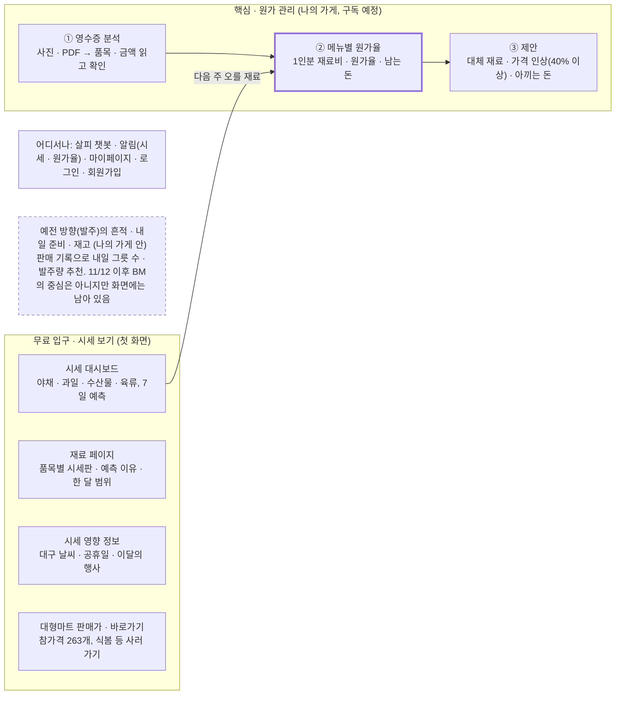

# 장바구니 프로젝트 흐름 정리 (11/16)

> 무엇: 10/27 ~ 11/16 동안 무엇을 했고, 어떤 정보를 얻었고, 왜 그 자료를 만들었는지 날짜순으로 정리
> 근거: 저장 기록(커밋) 약 220개 · `plan/` · `research/` 문서
> 온라인 문서(댓글 · 수정 가능): https://claude.ai/artifact/SLryMGXRDwXHp7L1pFDwmg

---

## 1. 한눈에 보는 큰 흐름

**한 줄로: "언제 살지 알려 주는 시세 예측"으로 시작했다가, 사장님 목소리(VOC)를 듣고 "이 메뉴 팔면 얼마 남는지 알려 주는 원가 관리"로 중심을 옮겼고, 시세 예측은 그 원가를 미리 지키는 도구가 됐다.**

| 단계 | 기간 | 질문 | 답(결정) |
| --- | --- | --- | --- |
| 1. 주제 정하기 | 10/27 ~ 10/30 | 대구에서 데이터로 뭘 풀까? | 대구 도매시장 시세를 예측해 사장님에게 "지금 살지, 기다릴지"를 알려 주자 |
| 2. 일단 만들기 | 11/3 ~ 11/6 | 시세 예측 서비스를 실제로 돌려 볼 수 있나? | 살피 사이트 완성. 시세 대시보드 + 챗봇 + 영수증 · 원가율 · 내일 준비까지 붙임 |
| 3. 근거 다지기 | 11/8 ~ 11/9 | 누가, 어떤 고통을 겪나? 예측은 맞나? | 페르소나 · 고객 여정 지도 · 페인포인트 Top 3. 이때까지 1위는 "언제 살지 모른다" |
| 4. 방향 바꾸기 | 11/11 ~ 11/13 | 사장님은 진짜 뭐가 힘든가? 누가 돈을 내나? | VOC 333장 → 1위는 "얼마 남는지 모른다"(원가). 원가 계산기는 이미 있으니 **내 영수증 + 시세 예측을 묶은 원가 관리**로 차별화 |
| 5. 마무리 | 11/16 ~ 12/4 | 무엇을 완성해서 발표하나? | 최종 일정 확정, AI 예측 자동 학습, 원가 화면 다듬기. 12/4 최종 발표 |

**헷갈리는 이유**: 2단계(11/3~11/6)에 "일단 다 만들어 보자"로 영수증 · 원가율 · 내일 준비(발주) · 대형마트 가격 · 행사 · 알림이 한꺼번에 들어갔습니다. 그런데 4단계에서 중심이 원가로 바뀌면서, 화면에는 옛 중심(시세 · 발주)과 새 중심(원가)이 함께 남아 있어요. 아래 3절 "살피 페이지 기능 지도"에서 무엇이 주인공이고 무엇이 조연인지 나눠 두었습니다.

---

## 2. 일자별 기록

기록이 없는 날(10/29, 10/31~11/2, 11/7, 11/10, 11/14)은 빠져 있습니다.

| 날짜 | 한 일 | 얻은 정보 | 왜 했나(의도) | 자료 |
| --- | --- | --- | --- | --- |
| 10/27 | 주제 후보 5개 조사 (라팍 음식 · 시니어 예매 · 관광지 상권 · 물류창고 · 도매시장 시세) | 도매시장 시세는 공공 API로 매일 무료로 쌓임 → 데이터가 가장 좋음 | 대구 · 푸드 트랙에서 데이터로 풀 수 있는 주제 고르기 | research/industry_food/1027_project_ideas_note.md |
| 10/28 | **주제 확정 · 주제 발표**: "대구 도매시장 시세 예측으로 분식집 사장님의 언제 · 얼마나 살지 알려 주는 발주 도우미". 대구 북구 재료 데이터 수집. 깃 규칙 문서 | 대구 도매시장 전국 3위(1조 1,217억), 양배추 3주 +67.7%, 음식점 재료비 비중 40.7% | "시세는 공개돼 있지만 사장님이 쓸 판단으로 바뀌어 있지 않다"는 문제 제기 | plan/proposal/1028_topic_pitch.md · research/industry_food/1028_wholesale_price_forecast_note.md |
| 10/30 | 식자재 업체 비교(푸디스트 vs 식봄), 제안서 PPT, **살피(미어캣) 캐릭터 시트** | 식봄 = CJ프레시웨이가 투자한 식자재 오픈마켓, AI 방향성이 더 뚜렷 | 연결할 판매처 고르기, 서비스 얼굴(캐릭터) 정하기 | research/industry_food/업체선정.md · brand/ |
| 11/3 | **개발 시작의 날**: 브랜드키트 · 로고, 공공 데이터 연결(aT 경매 · 대구 북부도매시장 · 축제 · KBO 일정), 살피 AI 에이전트 + 시세 대시보드 웹 첫 버전, Vercel 배포 | 날씨 · 행사 · 야구 경기처럼 시세에 영향을 주는 요인을 모음 | 11/4 발표에서 보여 줄 시연 사이트 만들기. 기획서의 서비스 정의를 "메뉴 원가 관리 AI"로 수정(이때부터 원가 단어가 등장) | salpi_agent/ · supabase/ · plan/brand_kit/ |
| 11/4 | **첫 발표(살피.pptx)**. 같은 날 기능 대량 추가: 내일 준비(판매 기록 → 내일 그릇 수 · 발주 추천), 영수증 사진 → 메뉴 원가율, 재료 페이지, 알림 · 마이페이지, **가상 사장님 10명 세그먼트 시뮬레이션** | 실제 가게 데이터가 없다는 약점 → 가상 사장님으로 보완 | 발표의 "다음 단계"(판매량 연동 · 영수증 OCR)를 바로 구현해 보기 | plan/presentation/1106/살피.pptx · data/simulation/ |
| 11/5 | 평일 17:40 자동 배포, 관광공사 행사 상세, **대형마트 판매가(참가격 263개)**, **기업 리서치: CJ프레시웨이** (서브에이전트 4분할) | CJ프레시웨이 2025 매출 3조 4,811억, 식봄 지분 55% 최대주주. 대구 도매시장에서 산다는 근거는 못 찾음 | 수업 과제(기업 분석 · 밸류체인)와 살피를 연결. 고추장 · 식용유 같은 가공 재료 가격도 보여 주려고 | research/company/ |
| 11/6 | 나의 가게 페이지(영수증 분석 · 메뉴별 원가율), 마이페이지, 폴더 정리(plan · research · data · brand), CJ 밸류체인 맵 | 11/4 이후 추가 기능 목록 정리 | 다음 발표 흐름 준비 | plan/presentation/1106/1106_presentation_flow.md |
| 11/8 | 예측 공식 v2 계획, 정답 없는 시뮬레이션(가상 10명 × 200판), PPT 수정 목록, 할 일 37개 로드맵 | 세그먼트 6개(소량 수시형 · 추천 따름형 · 휴면 등), 규칙 일치 90% | 고객을 나누는 기준과 예측 방법에 근거 만들기 | plan/1108_roadmap.md · plan/forecast/1108_forecast_formula_v2.md · data/simulation/1108_open_simulation_result.md |
| 11/9 | **고객 여정 지도 · 페르소나 10명 여정 · 페인포인트 Top 3**, 두 번째 발표(살피2), 시세 학습용 5년 치 데이터, 원가율 화면 · PDF 영수증 · 대체 재료 상자 | Top 3 = ① 언제 살지 모름(9점) ② 얼마나 살지 감으로(7점) ③ 메뉴마다 얼마 남는지 모름(8점). **통계 + 팀 가정**으로 만든 것 | 과제(고객 여정 → 페인포인트) 수행, 예측을 제대로 학습시킬 자료 확보 | plan/journey/ (HTML 3개) · data/raw/ |
| 11/10~11 | 화면 디자인 다듬기(대형마트 카드 · 색). **BM 재검토 시작**: VOC를 어떻게 모을지 결정 | 카페 크롤링은 약관 · 법 위험 → 캡처 + AI 분류로. 판매처가 연결 수수료를 낼 이유가 약함 | "예측은 도매 시세인데 연결은 식봄" → 연결고리가 약하다는 고민에서 출발 | plan/bm/1111_bm_voc_process.md |
| 11/12 | **VOC 333장 분석 → 방향 전환.** BM 캔버스 · 사용자 흐름 · AI 파이프라인 문서. 시세 범위를 과일 · 수산물 · 육류로 확대, 5년 자료로 예측 채점, 예측 기록 · 7일 뒤 자동 채점 | 사장님 고민 1위 = 원가 계산(59%) · 남는 게 없다(40%). "언제 살지"는 7%. 카페에 **무료 예측 도구 · 원가 계산기가 이미 있음**. 예전 예측 공식은 열에 네 번 반대로 말함 | 예측만으로는 차별점이 약해 **"내 영수증 · 내 메뉴와 연결된 원가"**를 중심으로, 시세는 그 재료로 | plan/bm/ (1112_voc_analysis · 1112_bm_canvas · 1112_user_flow · 1112_agent_pipeline) · plan/forecast/ |
| 11/13 | **세 번째 발표(살피3)** · 피드백. 경쟁사 비교표(도구 10개 × 기능 12개) · 포지셔닝 맵 · 시장 규모(TAM · SAM · SOM). 예측 적중률 정리. 화면을 머티리얼 디자인으로 | 피드백: 원가율 40% 기준 근거는? 40% 넘어도 대체 재료 추천 가능. 예측 정반대 과일 20% · 야채 26%는 크다 | 새 방향(원가 + 시세)이 시장에서 어디에 서 있는지 증명 | plan/bm/1113_* · plan/presentation/1113/1113_feedback_todo.md · plan/forecast/1113_* |
| 11/15~16 | 최종 일정 확정(README 달력, 역할 3명), **AI 예측이 매일 새벽 스스로 다시 학습**, 13개 예측 기법 비교, 대체 재료에 아끼는 금액 표시, 메뉴 수정 · 추가, 로그인 · 회원가입 화면 | 구독료 추천안: 무료 + 월 19,900원. 아끼는 돈이 구독료의 약 4.4배 | 12/4 최종 발표까지 누가 무엇을 할지, 발표 그림과 실제 코드를 맞추기 | plan/1116_final_sprint_plan.md · plan/1116_api_contract.md · README.md |

---

## 3. 살피 페이지 기능 지도

화면 기능은 많아 보여도 **네 묶음**뿐입니다. 사람을 모으는 무료 입구(시세), 돈을 받을 핵심(원가), 어디서나 쓰는 둘레 기능, 그리고 예전 방향에서 남은 발주 기능입니다.

읽는 법: 사장님은 왼쪽(무료 시세)으로 들어와서, 오른쪽(영수증 → 원가율 → 제안)에서 돈을 내는 구조입니다. 시세 예측은 "다음 주 오를 재료"로 원가율에 힘을 보태는 역할이에요. 점선 묶음(내일 준비 · 재고)은 처음 주제였던 "얼마나 살지"의 흔적이라, 헷갈릴 때는 일단 제외하고 보면 됩니다.

---

## 4. 자료 위치 안내

산출물은 대부분 `plan/` 폴더에 있고, 파일 이름 앞 4자리가 만든 날짜(월일)입니다. 먼저 읽을 것 순서로 적었어요.

| 자료 | 무엇을 위한 것 | 위치 |
| --- | --- | --- |
| **지금 방향 요약** (가장 먼저) | 11/9 전과 후가 무엇이 왜 바뀌었는지 한 표로 | [plan/presentation/1112_changes_and_flow.md](presentation/1113/1112_changes_and_flow.md) |
| VOC 분석 | 사장님 고민 순위 → 방향 전환의 근거 | [plan/bm/1112_voc_analysis.md](bm/1112_voc_analysis.md) (수집 방법은 [1111_bm_voc_process.md](bm/1111_bm_voc_process.md)) |
| BM 캔버스 | 누가 돈을 내나(구독 · 제휴 · 수요 리포트 · 공동구매) | [plan/bm/1112_bm_canvas.md](bm/1112_bm_canvas.md) |
| 사용자 흐름 | 영수증 → 원가율 → 제안으로 이어지는 화면 순서 | [plan/bm/1112_user_flow.md](bm/1112_user_flow.md) · plan/presentation/1113/살피_유저플로우_v2.png |
| AI 파이프라인 | 챗봇을 안내 담당 + 전문 담당 3개로 나누는 계획 | [plan/bm/1112_agent_pipeline.md](bm/1112_agent_pipeline.md) |
| 경쟁사 · 포지셔닝 · 시장 규모 | 도구 10개 비교, 원가 × 시세 두 축 지도, TAM · SAM · SOM | plan/bm/1113_경쟁사비교 · 1113_포지셔닝맵 · 1113_시장규모시트 (md · xlsx) |
| 고객 페르소나 | 고객 3종(사장님 · 영양사 · 구매 담당) + 브랜드 페르소나(살피) | [plan/brand_kit/살피_브랜드키트_기획서.md](brand_kit/살피_브랜드키트_기획서.md) 2절 |
| 고객 여정 지도 | 페르소나 10명의 하루, 페인포인트 Top 3(VOC 전 버전) | plan/journey/ (HTML 3개) |
| 가상 사장님 시뮬레이션 | 실제 가게 데이터 대신 세그먼트 기준 만들기 | [data/simulation/1108_open_simulation_result.md](../data/simulation/1108_open_simulation_result.md) |
| 시세 예측 | 공식 → 채점 → 적중률 → 매일 스스로 학습 | plan/forecast/ ([1116_self_learning_forecast.md](forecast/1116_self_learning_forecast.md)가 최신) |
| 기업 리서치 | CJ프레시웨이 사업 · 재무 · 밸류체인 | [research/company/1105_company_research_summary.md](../research/company/1105_company_research_summary.md) |
| 처음 주제 | 10/28 주제 발표와 근거 | [plan/proposal/1028_topic_pitch.md](proposal/1028_topic_pitch.md) |
| 앞으로 일정 | 11/16 ~ 12/4 역할 · 마감 | [README.md](../README.md) · [plan/1116_final_sprint_plan.md](1116_final_sprint_plan.md) |

---

## 5. 기록이 없어 확인이 필요한 부분

저장 기록과 문서만으로는 알 수 없었던 것들입니다. 답을 알면 위 표에 채워 넣습니다.

- [ ] **10/29, 10/31~11/2 (기록 없음)**: 주제 확정과 11/3 개발 시작 사이에 회의나 수업이 있었나요? 11/3에 서비스 정의를 "메뉴 원가 관리 AI"로 바꾼 이유도 이때 나왔을 것 같아요.
- [ ] **10/30 제안서 PPT**: "식자재 가격 분석 AI 알림 스마트 발주 지원 플랫폼" 제안서는 어디에 제출한 건가요? 수업 과제인지 대회인지 궁금해요.
- [ ] **발표 3번(11/4 · 11/9 · 11/13)의 성격**: 각각 누구 앞에서 한 발표인가요? 11/4 · 11/9 발표 피드백은 기록이 없고, 11/13 피드백만 문서로 남아 있어요.
- [ ] **고객 페르소나 3종**: 브랜드키트에 "PPT 조사 결과를 바탕으로 만든 가상 설계"라고 적혀 있는데, 어느 PPT의 어떤 조사인가요? 실제 사장님을 만나거나 설문한 적이 있나요?
- [ ] **11/12 방향 전환 회의**: "팀 결정안"이라고 되어 있는데, 팀원 모두 동의한 회의가 있었나요? "원가 계산기가 이미 있는데도 하는 이유"를 팀이 어떻게 정리했는지 기록해 두면 발표에서 처음 받을 질문에 대비돼요.
- [ ] **내일 준비 · 재고를 남길지**: 최종 계획에는 "재고 입력 화면"을 더 만드는 것으로 되어 있어요. 발표에서 이걸 핵심(원가)의 일부로 말할지, 부가 기능으로 둘지 팀이 정했나요?
- [ ] **윤가언 담당 부분**: 저장 기록상 10/28 대구 북구 데이터, 11/3 축제 · KBO · 도매시장 데이터, 11/4 가상 사장님 시뮬레이션, 11/9 고객 여정 지도 · 5년 치 데이터, 11/13 예측 적중률 정리가 윤가언 작업이에요. 빠진 게 있으면 알려 주세요.
