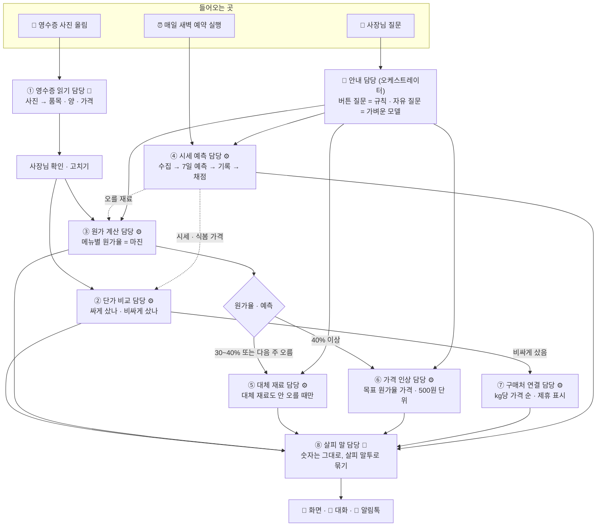

# 살피 AI 에이전트 파이프라인 (서브에이전트 역할 나누기, 11/12)

> 무엇: [사용자 흐름](1112_user_flow.md)의 각 단계를 어느 에이전트(담당)가 맡는지, 서로 무엇을 주고받는지 정리
> 짝 문서: [비즈니스 모델](1112_bm_canvas.md)
> 앞 문서: [1111_bm_voc_process.md](1111_bm_voc_process.md) §7 (나누기 원칙 · 주의점 12개)
> 가정: 서브에이전트로 나눈다. 단, **AI 모델이 꼭 필요한 곳만 모델을 쓰고 나머지는 계산(규칙)으로** 처리한다 — 무료 호출 한도와 속도 때문

---

## 1. 그림: 세 갈래로 들어와 한 곳에서 나간다



🤖 = AI 모델을 씀 · ⚙️ = 모델 없이 계산 (빠르고 공짜, 같은 입력이면 늘 같은 답)

---

## 2. 담당별 역할

| # | 담당 | 하는 일 | 받는 것 | 내놓는 것 | 모델 | 지금 코드 |
|---|---|---|---|---|---|---|
| 0 | **안내** (오케스트레이터) | 질문을 어느 담당에 보낼지 정함. 섞인 질문은 여러 담당을 **동시에** 부르고 결과를 순서대로 붙임 | 질문 + 최근 대화 몇 줄 | 부를 담당 목록 | 버튼 질문은 규칙, 자유 질문만 가벼운 모델 | `agent.py` (지금은 한 덩어리) |
| ① | **영수증 읽기** | 사진에서 품목 · 양 · 단위 · 가격 읽기, 살피 재료 이름에 맞추기 | 사진 | 품목 표 (사장님이 확인 · 고침) | 🤖 사진 읽는 모델, 바쁘면 다음 모델로 | `receipts.read` ✅ |
| ② | **단가 비교** | 산 값을 kg당으로 바꿔 같은 주 도매 시세 · 식봄 kg당 가격과 비교 → 싸게 / 보통 / 비싸게, 아낀 돈 | 품목 표 + 시세 + `price_snapshots` | 품목별 판정 · 차이(원) | ⚙️ | ⬜ 새로 |
| ③ | **원가 계산** | 레시피 × 최근 영수증 단가(손질 손실 포함)로 1인분 원가 · 원가율 · 남는 돈, 가장 많이 오른 재료 찾기 | 메뉴 · 레시피 · 영수증 단가 | 메뉴별 원가율 · 판정 · 오른 재료 | ⚙️ | `receipts.cost_report` ✅ |
| ④ | **시세 예측** | 매일 시세 받기 → 7일 예측 → 예측 기록 → 7일 지난 것 채점 → 식봄 가격 기록 | 공공 데이터 · 날씨 · 행사 · 공휴일 | 재료별 예측 · 적중률 | ⚙️ | `analysis.py` · `forecast_log.py` ✅ |
| ⑤ | **대체 재료** | 오른(또는 오를) 재료의 대체 후보를 고르고, **대체 재료도 예측해서 안 오를 때만** 추천. 바꾸면 원가율이 얼마가 되는지 계산 | 오른 재료 + ④ 예측 | 대체 재료 · 바꾼 뒤 원가율 | ⚙️ | `SUBSTITUTES` 🟡 (예측 확인 · 원가율 다시 계산 추가) |
| ⑥ | **가격 인상** | 원가율 40% 이상일 때만, 목표 원가율 30%가 되는 판매가 (500원 단위 올림) | 원가 · 판매가 | 제안 가격 · 올린 뒤 원가율 | ⚙️ | `cost_report` tips 🟡 (기준 40%로) |
| ⑦ | **구매처 연결** | 비싸게 산 품목만, 판매처를 kg당 가격 순으로. 산 값보다 싼 곳만, 제휴 링크는 표시 | ② 판정 + 판매처 가격 | 링크 목록 | ⚙️ | 식봄 상품 목록 🟡 |
| ⑧ | **살피 말** | 담당들이 낸 숫자를 바꾸지 않고 살피 말투 · 10줄 안으로 묶기. 알림톡 문장 | 담당 결과(숫자 포함) | 말풍선 · 대화 답 · 알림톡 | 🤖 (대화일 때만). 화면 말풍선 · 알림은 문장 틀로 ⚙️ | `brand/SKILL.md` + `salpiSays` |

---

## 3. 세 갈래 흐름의 예

### A. 영수증을 올렸을 때 (모델 호출 1번)

```
① 영수증 읽기 🤖 → 사장님 확인 → ② 단가 비교 ⚙️ ┐
                                 └ ③ 원가 계산 ⚙️ ┴→ ⑤·⑥·⑦ ⚙️ (해당될 때만) → ⑧ 문장 틀 ⚙️ → 화면
```
- 모델은 **사진 읽기 한 번만**. 판정 · 추천 · 말풍선은 전부 계산이라 빠르고 공짜

### B. 사장님이 물었을 때 (모델 호출 1~2번)

| 질문 | 안내가 부르는 담당 | 모델 호출 |
|---|---|---|
| [버튼] "지금 사야 할 재료?" | ④ | ⑧ 1번 (안내는 규칙) |
| "김치찌개 얼마 남아?" | ③ | 안내 1 + ⑧ 1 |
| "양파 올라서 김치찌개 남아?" (섞인 질문) | ④ + ③ + ⑤ **동시에** | 안내 1 + ⑧ 1 |
| "이번 영수증 비싸게 산 거 있어?" | ② (+ ⑦) | 안내 1 + ⑧ 1 |

### C. 매일 새벽 (모델 호출 0번)

```
④ 시세 받기 → 예측 → 기록 → 채점 → 식봄 가격 기록
   → ③ 가게마다 원가율 다시 계산 (시세가 바뀐 재료만)
   → 원가율이 판정 경계(30% · 40%)를 넘은 가게만 → ⑤·⑥ → ⑧ 알림톡 문장 틀 → 아침 알림
```

---

## 4. 담당끼리 주고받는 약속 (데이터 모양)

담당을 바꿔도 서로 안 깨지게, 주고받는 모양을 고정합니다. **모든 숫자에는 기준을 붙입니다** (같은 양파 값이 둘로 나오는 문제 방지 — 1111 문서 주의점 4).

```json
// ② 단가 비교 → ⑦ · ⑧
{"item": "양파", "paid_per_kg": 1450, "basis": "영수증 11/12",
 "wholesale_per_kg": 980, "shop_per_kg": 1300, "shop": "식봄",
 "verdict": "비싸게", "diff_per_kg": 150}

// ③ 원가 계산 → ⑤ · ⑥ · ⑧
{"menu": "김치찌개", "price": 9000, "cost_per_serving": 2430,
 "cost_ratio_pct": 27.0, "verdict": "충분해요", "riser": {"item": "양파", "change_pct": 12}}

// ④ 시세 예측 → ③ · ⑤ · ⑧
{"item": "양파", "expected_change_pct": 6.5, "direction": "up",
 "basis": "북부도매시장 경락가", "formula_version": "2026-11-12"}
```

---

## 5. 지켜야 할 것

| 규칙 | 이유 |
|---|---|
| **숫자는 ⚙️ 담당만 만든다.** ⑧ 살피 말은 숫자를 바꾸거나 새로 만들지 않는다 | AI가 그럴듯한 숫자를 지어내는 것 방지 |
| 공통 규칙(살피 말투 · 판매처 강요 안 함 · 판단은 사장님)은 `brand/SKILL.md` **한 곳에만** | 담당마다 복사하면 하나만 고쳐짐 |
| 담당마다 시간 제한, 넘으면 "잠시 후 다시" | Vercel 요청 시간 제한 |
| 질문마다 "어느 담당 · 어떤 도구 · 걸린 시간" 기록 | 틀린 답의 원인 찾기 |
| 나누기 전 · 후를 시험 질문 6개로 비교 (속도 · 호출 수 · 도구 정확도) | 좋아졌을 때만 유지 (1111 문서 7-5) |

---

## 6. 12/4까지 나누는 순서

| 순서 | 할 것 | 왜 먼저 |
|---|---|---|
| 1 | 지금 한 덩어리 살피의 속도 · 호출 수 재기 (시험 질문 6개) | 비교 기준 |
| 2 | ② 단가 비교 · ⑥ 기준 40% · ⑤ 예측 확인 (모두 계산이라 모델 호출 없음) | 사용자 흐름의 새 화면에 바로 필요 |
| 3 | C. 새벽 갈래: 원가율 다시 계산 → 알림 문장 틀 | 모델 호출 0, 효과 큼 |
| 4 | 안내 담당: 버튼 질문은 규칙으로 바로 보내기 | 호출 1번 절약 |
| 5 | 자유 질문을 담당별 도구로 나누기 (원가 → 시세 순) | 효과를 재 보고 좋아질 때만 |

발표 직전(12/1 이후)에는 구조를 바꾸지 않습니다.

**슬라이드 한 줄**: AI는 사진 읽기와 말하기에만 쓰고, 원가 · 판정 · 추천은 계산으로 — 빠르고, 공짜고, 숫자를 지어내지 않는다.
