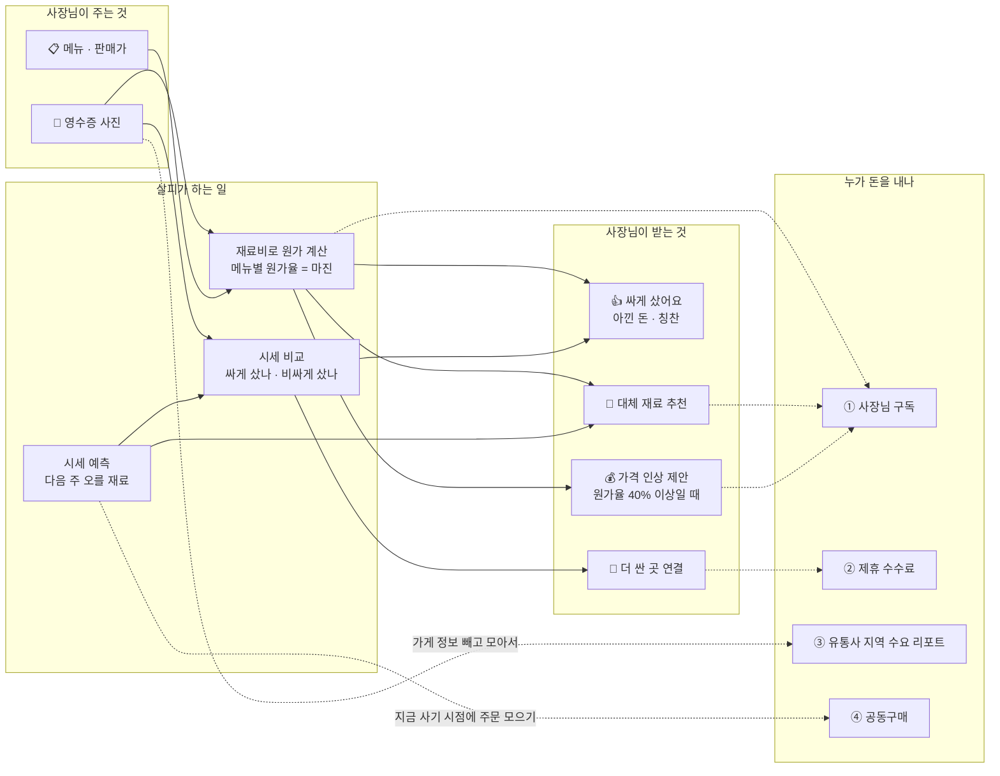

# 살피 비즈니스 모델 (11/12 팀 결정안)

> 무엇: 팀이 정한 흐름 그림(시세 예측 ↔ 영수증 분석 → 마진 → 대체 재료 · 가격 인상 · 제휴 연결)을 비즈니스 모델로 정리
> 근거: [1112_voc_analysis.md](1112_voc_analysis.md) (VOC 333장), [1111_bm_voc_process.md](1111_bm_voc_process.md) §6-4 (수익 구조 정리안)
> 짝 문서: [사용자 흐름](1112_user_flow.md) · [AI 에이전트 파이프라인](1112_agent_pipeline.md)

---

## 0. 한 줄

**"영수증만 찍으면, 내 메뉴가 얼마 남는지 · 재료를 싸게 샀는지 · 다음 주엔 뭘 바꿔야 하는지 살피가 알려 준다."**

- VOC에서 사장님 고민은 "언제 살까"(7%)보다 **"얼마 남나"(원가 계산 59% · 남는 게 없다 40%)**가 훨씬 많음
- 그래서 중심은 **영수증 → 마진**, 시세 예측은 그 마진을 **미리 지키는 도구**

---

## 1. 그림: 가치가 만들어지고 돈이 되는 길

---

## 2. 비즈니스 모델 캔버스 (9칸)

| 칸 | 내용 |
|---|---|
| **고객** | 대구 외식 자영업 사장님 (1~5인 가게, 분식 · 한식 · 찌개류처럼 야채 · 고기 재료 비중이 큰 곳). 원가를 영수증 · 메모 · 엑셀로 손으로 계산하는 사람 |
| **가치 제안** | ① 영수증만 찍으면 **메뉴별 원가율 · 남는 돈**이 자동 계산 ② 재료값이 바뀌면 **원가율이 저절로 다시 계산** ③ 내가 산 값이 **시세보다 비싼지** 바로 확인 ④ 다음 주 오를 재료를 미리 알려 **대체 재료 · 가격 인상**을 제때 판단 |
| **채널** | 웹앱(휴대폰 화면 기준), 카카오 알림톡(아침 브리핑 · 원가율 경고), 자영업자 카페 · 대구 상인회 |
| **고객 관계** | 살피 캐릭터가 말 걸듯이 알려 줌. 잘했을 때 칭찬("이번 주 양파 싸게 사셨어요"), 위험할 때만 경고. 판단은 사장님이 (살피는 권하지만 강요 안 함) |
| **수익원** | 아래 3절 |
| **핵심 자원** | 대구 북부도매시장 경락가 · KAMIS 5년 시세 · 축산물품질평가원 등급별 경락가, 사장님 영수증 · 메뉴 데이터, 예측 채점 기록(적중률) |
| **핵심 활동** | 영수증 읽기 · 원가 계산, 시세 수집 · 7일 예측 · **매일 채점**, 판매처 가격 수집(식봄 등) |
| **핵심 파트너** | 공공 데이터(aT · KAMIS · 축산물품질평가원 · 기상청), 판매처 제휴 프로그램(쿠팡 파트너스 · 네이버 쇼핑 커넥트), 식자재 유통사(CJ프레시웨이 – 식봄 운영사 최대주주) |
| **비용** | AI 모델 호출(영수증 읽기 · 대화), 서버(Vercel) · 데이터베이스(Supabase), 데이터 수집 유지보수 |

---

## 3. 수익 구조

| 순서 | 누가 내나 | 무엇에 | 그림의 어디 | 언제 |
|---|---|---|---|---|
| ① 핵심 | 사장님 | **유료 구독**: 영수증 분석 · 메뉴 원가율 · 대체 재료 · 가격 인상 제안 · 알림. 시세 대시보드 · 7일 예측은 무료 (사람을 모으는 입구) | 영수증 분석 → 마진 | 처음부터 |
| ② 바로 가능 | 판매처 (자동) | **제휴 링크 수수료**: "비싸게 샀어요 → 여기가 더 싸요" 연결. 쿠팡 파트너스 · 네이버 쇼핑 커넥트처럼 이미 열린 프로그램 | 비싸게 샀는지 확인 → 연결해 둔 곳 | 처음부터 |
| ③ 확장 | 식자재 유통사 · 도매상 | **지역 수요 리포트**: "다음 주 대구 분식집 양파 수요 ↑" (가게 개별 정보는 빼고 모은 숫자만) | 영수증 데이터가 쌓인 뒤 | 사용자 수십 곳 이상 |
| ④ 확장 | 도매상 | **공동구매**: 예측이 "지금 사기"일 때 주문을 모아 대량 할인 | 시세 예측 | 사용자 수십 곳 이상 |
| 보조 | 공공 | 소상공인 디지털 전환 지원사업 바우처 | — | — |

### 제휴 수익의 규칙 (중립성 지키기)

"비싸게 샀으니 여기서 사세요"는 돈과 직접 연결되므로, 광고 앱처럼 보이지 않게 아래를 지킵니다.

1. **실제로 더 쌀 때만** 연결합니다. kg당 가격을 계산해 사장님이 산 값보다 낮을 때만 보여 줍니다.
2. **판매처를 하나만 보여 주지 않습니다.** 식봄 · 대형마트 · 쿠팡 등을 kg당 가격 순으로 같이 보여 줍니다.
3. 링크에 **"제휴 링크"**라고 반드시 표시합니다. 공정위 추천 · 보증 심사지침에 따른 것입니다.
4. 제휴가 없는 곳이 더 싸면 **그곳을 먼저** 보여 줍니다.

---

## 4. 그림 속 숫자 · 말의 기준 (팀 결정 + 정할 것)

| 그림의 말 | 기준 | 상태 |
|---|---|---|
| 가격 인상 조정 추천 **(원가율 40% 이상)** | 원가율 40% 이상이면 가격 인상 제안. 30~40%는 "빠듯해요" + 대체 재료 먼저. 지금 코드(`receipts.py`)는 30% 넘으면 바로 인상 제안 → **40%로 바꿀 것** | 팀 결정, 코드 수정 필요 |
| 싸게 샀는지 · 비싸게 샀는지 | 영수증 kg당 단가를 **같은 주 도매 시세 + 판매처(식봄) 판매가**와 비교. "도매 ~ 식봄 사이"면 보통, 식봄보다 비싸면 비싸게 | 식봄 vs 도매 차이가 1주 쌓이는 11/19에 범위 확정 |
| **상위 1% 사장님**이에요 | 다른 가게 영수증과 비교해야 나오는 말. 사용자가 적은 지금은 **"도매 시세에 가깝게 사셨어요 (식봄보다 kg당 ○○원 쌈)"**로 대신하고, 가게가 30곳 넘게 모이면 "상위 ○%"로 바꿈 | 거짓 순위를 만들지 않기 위해 처음엔 쓰지 않음 |
| 다음 주 시세 높아질 예정 → 다른 재료 어때? | 7일 예측이 "오를 가능성" + 그 재료가 원가에서 큰 몫일 때. 대체 재료도 예측해서 **대체 재료가 안 오를 때만** 추천 | 대체 재료 표(`SUBSTITUTES`) 6개 → 늘릴 것 |
| 마진 good | 원가율 30% 이하 ("충분해요") | 지금 코드와 같음 |

---

## 5. 경쟁 도구와의 차이

| | 무료 도매가 예측 도구 (카페에서 발견) | 원가 계산기 (카페 홍보 글) | **살피** |
|---|---|---|---|
| 시세 예측 | ○ (210개 품목) | × | ○ (대구 도매시장 기준 + 채점 공개) |
| 메뉴 원가율 | × | ○ (손으로 입력) | ○ (**영수증 사진으로 자동**) |
| 재료값 바뀌면 원가율 자동 갱신 | × | × | ○ |
| 싸게 샀는지 비교 | × | × | ○ |
| 다음 할 일 (대체 재료 · 가격 인상) | × | × | ○ |

**슬라이드 한 줄**: 시세는 누구나 보여 준다. 살피는 **내 영수증과 내 메뉴**에 시세를 연결해 "얼마 남는지, 다음 주엔 뭘 바꿀지"를 알려 준다.

---

## 6. 아직 확인 못 한 것 (발표 때 정직하게)

| 가정 | 확인 방법 | 시점 |
|---|---|---|
| 사장님이 돈을 낼까, 얼마면 낼까 | 사장님 설문 · 인터뷰 (뒤로 미룸) | 미정 |
| 식봄 판매가가 도매를 따라 움직일까, 살피 예측이 식봄 값 방향도 맞힐까 | 예측 기록 + 식봄 판매가 비교 ([1112_forecast_log.md](../forecast/1112_forecast_log.md)) | 11/19 첫 결과, 12/3 2주 치 |
| 예측이 실제로 맞나 | 7일 뒤 자동 채점 | 11/18~19 첫 채점 |
