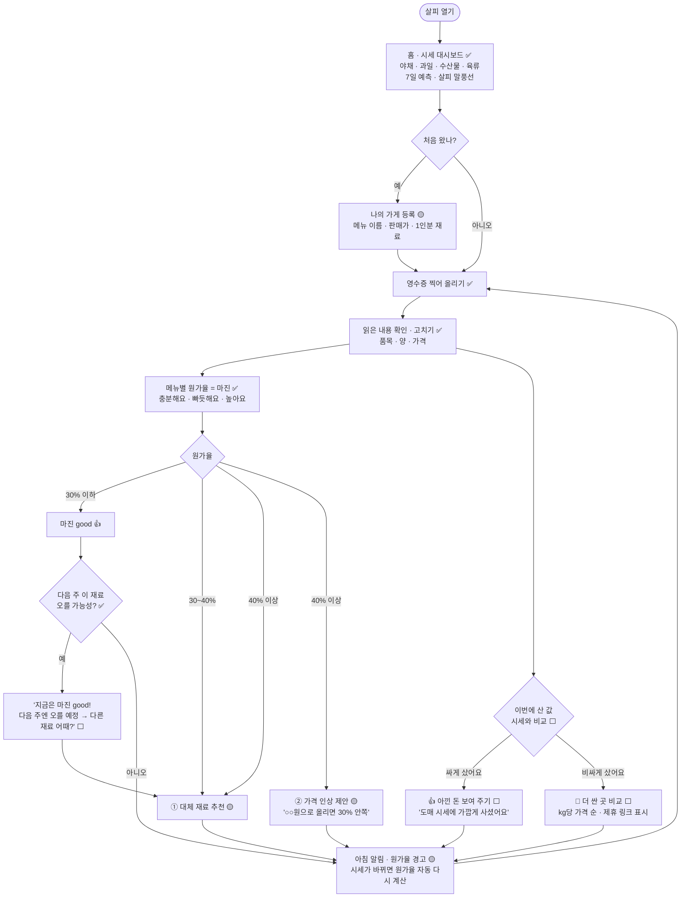

# 살피 사용자 흐름 (유저플로우, 11/12)

> 무엇: 사장님이 살피를 처음 열고 → 영수증을 올리고 → 결과에 따라 무엇을 보게 되는지 화면 순서로 정리
> 짝 문서: [비즈니스 모델](1112_bm_canvas.md) · [AI 에이전트 파이프라인](1112_agent_pipeline.md)
> 표시: ✅ 지금 화면에 있음 · 🟡 일부 있음(고칠 것) · ⬜ 새로 만들 것

---

## 1. 그림: 전체 흐름

**고리 구조**: 영수증을 올릴 때마다 원가율이 새로 계산되고, 시세가 바뀌면 알림이 와서 다시 영수증을 올리게 됩니다. 이 고리가 **구독을 계속 쓰게 만드는 장치**입니다.

---

## 2. 화면별 정리

| # | 화면 | 사장님이 하는 일 | 살피가 보여 주는 것 | 상태 | 지금 어디 |
|---|---|---|---|---|---|
| 1 | 홈 · 시세 대시보드 | 둘러보기, 재료 검색 | 재료별 시세 · 7일 예측 · 비 · 행사 · 공휴일 · 살피 말풍선 | ✅ | 첫 화면, `?item=` 상세 |
| 2 | 나의 가게 등록 | 메뉴 · 판매가 · 1인분 재료 입력 | 기본 메뉴 예시 (김치찌개 등) | 🟡 메뉴 직접 추가 화면 필요 | 나의 가게 |
| 3 | 영수증 올리기 | 사진 찍기 | 읽는 중 표시 | ✅ | 나의 가게 › 영수증 |
| 4 | 읽은 내용 확인 | 틀린 품목 · 가격 고치기 | 품목 · 양 · 가격 · 합계 확인 | ✅ | 영수증 상세 |
| 5 | **싸게 · 비싸게 판정** | 결과 보기 | 품목마다 "도매 ~ 식봄 범위" 중 어디인지 막대 하나로 | ⬜ | 새로 (영수증 저장 직후) |
| 6 | 메뉴별 원가율 | 메뉴 누르기 | 원가율 · 1인분 남는 돈 · 큰 재료 3개 | ✅ | 나의 가게 › 원가 |
| 7 | 대체 재료 추천 | 바꿀지 고르기 | "양파 일부를 양배추로" + 이유 + 대체 재료도 안 오를지 | 🟡 대체 재료 예측 확인 추가 | 원가 화면 상자 |
| 8 | 가격 인상 제안 | 올릴지 고르기 | "○○원으로 올리면 30% 안쪽" (원가율 40% 이상일 때만) | 🟡 기준 30% → 40% | 원가 화면 |
| 9 | 더 싼 곳 비교 | 링크 누르기 | 식봄 · 대형마트 · 쿠팡 kg당 가격, "제휴 링크" 표시 | ⬜ (식봄 상품 목록은 있음) | 영수증 결과 아래 |
| 10 | 알림 | 받기 · 설정 | 아침 브리핑, "양파 +12% → 김치찌개 원가율 31%→33%" | 🟡 원가율 연결 알림 필요 | 마이페이지 › 설정 › 알림 |
| 11 | 살피에게 묻기 | 자유 질문 | 위 모든 정보를 대화로 | ✅ | 채팅 |

---

## 3. 결과별 살피 말 (예시)

| 상황 | 살피 말풍선 | 캐릭터 |
|---|---|---|
| 싸게 샀어요 | "이번 양파는 도매 시세에 가깝게 사셨어요! 식봄보다 kg당 300원 아끼셨어요 👍" | 웃는 얼굴 |
| 비싸게 샀어요 | "이번 대파는 식봄보다 kg당 800원 비쌌어요. 다음엔 여기서 비교해 보세요" | 고민 |
| 마진 good + 다음 주 오름 | "김치찌개 지금은 원가율 27%로 좋아요! 다만 양파가 다음 주 오를 것 같아요. 양배추 섞는 건 어때요?" | 알람 시계 |
| 원가율 30~40% | "제육볶음 원가율 36%, 빠듯해요. 앞다리 일부를 뒷다리로 바꾸면 33%까지 내려가요" | 고민 |
| 원가율 40% 이상 | "제육볶음 원가율 42%예요. 9,500원으로 올리면 30% 안쪽이에요. 근처 같은 메뉴는 9,000~10,000원이에요" | 경고 |

- 판단은 사장님이 합니다. 살피는 **"검토해 보세요"**까지만 말합니다 (brand/SKILL.md 원칙).
- "근처 같은 메뉴 가격"은 데이터를 구한 뒤 넣습니다. 없으면 이 문장은 뺍니다.

---

## 4. 12/4까지 만들 순서

| 순서 | 할 것 | 화면 # |
|---|---|---|
| 1 | 가격 인상 기준 30% → 40%, 30~40%는 대체 재료 먼저 | 7 · 8 |
| 2 | 싸게 · 비싸게 판정 (도매 시세 · 식봄 kg당 가격과 비교) | 5 |
| 3 | 더 싼 곳 비교 (식봄 상품 목록 재사용 + 제휴 표시) | 9 |
| 4 | "마진 good + 다음 주 오름" 말풍선 | 6 |
| 5 | 시세 변화 → 원가율 다시 계산 알림 | 10 |
