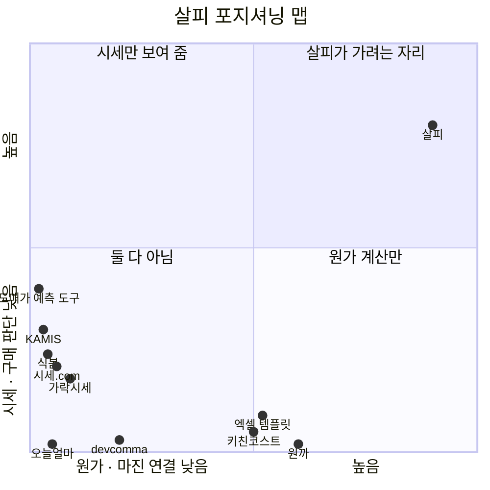

# 살피 포지셔닝 맵 (11/13)

> 무엇: 경쟁 도구 10개와 살피를 "원가 · 마진 연결" × "시세 · 구매 판단" 두 축에 놓음
> 엑셀(수식 · 점 그래프): [1113_포지셔닝맵.xlsx](1113_포지셔닝맵.xlsx) · 기호 근거: [1113_경쟁사비교.md](1113_경쟁사비교.md)
> 확인일: 2026-11-13

---

## 1. 지도

점이 겹치지 않게 0.01~0.09만큼 옮겨 그림. 정확한 점수는 2절

---

## 2. 점수

축마다 기능 5개, ○ 1점 · △ 0.5점을 더해 10점 만점으로 바꿈

| 도구 | 가로: 원가 · 마진 연결 | 세로: 시세 · 구매 판단 | 자리 |
|---|---|---|---|
| **살피** | **9.0** | **8.0** | 오른쪽 위 (혼자) |
| 원까 | 6.0 | 0.0 | 오른쪽 아래 |
| 키친코스트 | 5.0 | 0.0 | 오른쪽 아래 |
| 엑셀 · 구글 시트 템플릿 | 5.0 | 0.0 | 오른쪽 아래 |
| devcomma 원가율 계산기 | 2.0 | 0.0 | 왼쪽 아래 |
| 도매가 예측 무료 도구 | 0.0 | 4.0 | 왼쪽 위 |
| KAMIS | 0.0 | 3.0 | 왼쪽 위 |
| 시세.com | 0.0 | 2.0 | 왼쪽 아래 |
| 가락시세 | 0.0 | 2.0 | 왼쪽 아래 |
| 식봄 | 0.0 | 2.0 | 왼쪽 아래 |
| 오늘얼마 (OKPOS) | 0.0 | 0.0 | 왼쪽 아래 |

### 축에 쓴 기능

| 축 | 기능 5개 |
|---|---|
| 가로: 내 메뉴 원가 · 마진까지 연결 | 레시피(g) 원가 · 영수증 사진 입력 · 재료값 바뀌면 원가율 자동 갱신 · 목표 원가율 → 판매가 · 다음 행동 제안 |
| 세로: 시세로 언제 · 싸게 살지 판단 | 시세 조회 · 시세 예측 · 예측 채점 공개 · 대구 시세 · 산 값이 시세보다 싼지 |

- 살피 가로 9.0: 원가율 자동 갱신이 △ (영수증 기준은 됨, 시세 변화 → 자동 알림은 만드는 중)
- 살피 세로 8.0: 채점 공개 △ (문서 공개, 화면 표시는 만드는 중) · 싸게 샀나 △ (만드는 중)

---

## 3. 읽는 법

| 자리 | 뜻 | 도구 |
|---|---|---|
| 오른쪽 위 | 원가 · 마진 + 시세 판단 둘 다 | **살피 혼자 (빈 자리)** |
| 오른쪽 아래 | 원가 계산은 하지만 시세는 모름 | 원까 · 키친코스트 · 엑셀 템플릿 |
| 왼쪽 위 | 시세는 보여 주지만 내 메뉴와 안 이어짐 | 도매가 예측 도구 · KAMIS |
| 왼쪽 아래 | 둘 다 약함 | 시세.com · 가락시세 · 식봄(구매 · 가격 비교) · 오늘얼마(매출) |

**발표 한 줄**: 원가 계산 도구는 오른쪽 아래, 시세 도구는 왼쪽 위에 모여 있다. **둘을 잇는 오른쪽 위가 비어 있고, 살피가 그 자리**

**주의**: 원까가 시세 연동을 붙이면 오른쪽 위로 올라올 수 있음 → 살피의 버팀목은 **대구 경락가 예측 + 채점 공개**
