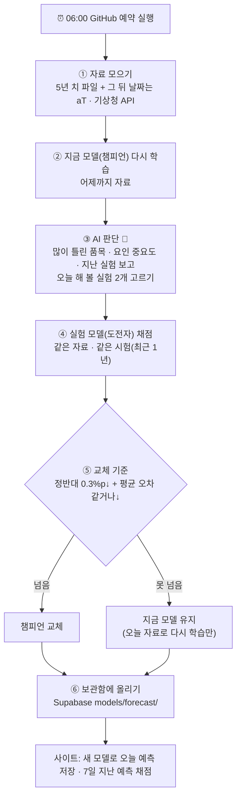

# 스스로 배우는 시세 예측 (AI 학습 모델 · 매일 새벽, 11/16)

> 무엇: 사람이 정한 고정 공식 대신, **매일 새벽 AI가 다시 배우고 · 시험하고 · 더 잘 맞을 때만 스스로 바꾸는** 7일 시세 예측
> 계기: "고정된 산식보다 AI 학습 모델로, 변동이 AI를 통해 자율적으로 이루어지게" 피드백
> 앞 문서: [부스팅 비교](1112_boosting_compare.md) · [시세 검증 에이전트 계획](1112_forecast_validation_agent.md) · [AI 에이전트 파이프라인](../bm/1112_agent_pipeline.md)
> 코드: [learner.py](../../salpi_agent/price/learner.py) (학습 담당) · [forecast_model.py](../../salpi_agent/price/forecast_model.py) (화면 예측) · [daily-learn.yml](../../.github/workflows/daily-learn.yml) (매일 06:00)

---

## 0. 한 줄

**정반대를 줄이되 평균 오차는 절대 나빠지지 않게. 그 기준을 넘을 때만 AI가 스스로 모델을 바꾼다.**

---

## 1. 매일 새벽 흐름 (야채 · 과일 따로)

| 단계 | 누가 | 하는 일 |
|---|---|---|
| ① 자료 | 코드 | `data/raw/1109_5y` (2021-01 ~ 2026-11-07) + 그 뒤 날짜는 API로 받아 보관함 `recent_data.json` 에 쌓음 |
| ② 다시 학습 | 코드 (부스팅, `gbdt.py`) | 매일 하루치 자료가 늘어난 채로 다시 학습 |
| ③ 실험 고르기 | **AI (제미나이)** | 정해진 목록(요인 빼기 · 넣기, 학습 설정 바꾸기) 안에서 2개 + 고른 이유 · 진단. 최근 2주에 해 본 것은 피함. AI를 못 쓰면 안 해 본 것부터 차례로 |
| ④ 채점 | 코드 | 숫자는 코드만 만듦 (AI가 숫자를 지어내지 않음) |
| ⑤ 교체 | 코드 (미리 정한 기준) | 기준을 넘는 실험이 여럿이면 정반대가 가장 낮은 것 |
| ⑥ 배포 | 코드 | 전체 자료로 학습한 모델 + 품목별 예상 범위 폭 + 계절 표를 올림. 서버는 1시간 안에 새 모델을 읽음 |

**안전장치**
- 고정 공식보다 정반대 · 평균 오차가 **둘 다** 낫거나 같을 때만 화면에 AI 모델을 씀. 아니면 고정 공식 그대로
- 모델을 못 읽거나 계산이 실패하면 그 품목은 고정 공식으로 (화면은 멈추지 않음)
- 예측마다 모델 버전(`ai-veg-20261116` 등)을 붙여 `forecast_log` 에 저장 → 실제 채점도 버전별로 볼 수 있음

---

## 2. 지표 3개

| 쓰임 | 지표 | 뜻 |
|---|---|---|
| **목표** | 정반대 | 오른다 했는데 내렸거나 그 반대 (±2% 기준). 사장님이 손해 보는 경우 → 10% 이하가 목표 |
| **안전장치** | 평균 오차 | \|예상 변화율 − 실제 변화율\| 평균 (%p). "다 비슷해요"로 정반대만 줄이는 꼼수를 막음 |
| 화면 · 사장님용 | 범위 적중 | 7일 뒤 실제 값이 화면의 예상 범위 안에 든 비율. 범위 폭은 지난 1년 오차의 70% 지점 |

- 방향 적중은 기록만 하고 판단에는 쓰지 않음
- 가락시장 선행 · 날씨 예보 같은 새 자료는 지표가 아니라 **실험**으로: 넣어서 위 두 지표가 좋아지면 채택

---

## 3. 첫 결과 (11/16, 시험 기간 2025-11-08 ~ 2026-11-07)

| 종류 | 방법 | 정반대 | 평균 오차 | 범위 적중 |
|---|---|---|---|---|
| 야채 | 고정 공식 | 28.1% | 19.20%p | 71.2% |
| 야채 | **AI 모델** | **23.1%** | **17.88%p** | 73.1% |
| 과일 | 고정 공식 | 21.8% | 14.41%p | 69.7% |
| 과일 | **AI 모델** (첫날 스스로 교체) | **19.7%** | **12.94%p** | 70.4% |

- 첫날 AI가 고른 실험: 야채 "한파 일수 빼기" · "1주 전 대비 넣기" → 둘 다 기준 못 넘어 유지 / 과일 "날씨 점수 빼기" · "1주 전 대비 넣기" → **1주 전 대비 넣기로 교체**
- 목표 10%까지는 아직 멂 → 대구 밖 자료(가락시장 선행 · 주산지 날씨 · 날씨 예보)를 실험 목록에 넣는 것이 다음 단계

---

## 3-1. 13개 기법 품목별 매칭 (11/16, [method_match.py](../../salpi_agent/experiments/method_match.py))

**질문**: 어떤 예측 기법이 맞는지 미리 모르니, 13개를 다 돌려 품목마다 실제와 가장 가까운 기법을 데이터로 고르면 더 잘 맞을까?

**방법**: 연도별로 굴려 검증. 2023 시험 ← 그 전으로 학습 / 2024 시험 ← 그 전 / 2025~26 시험 ← 그 전. **2023 · 2024 성적으로 품목마다 기법을 고르고, 고를 때 안 본 2025~26에서 확인.** 학습 기간도 2년 · 3년 · 전부(최대 약 4년)로 비교

| 묶음 | 기법 |
|---|---|
| 단순 | ① 그대로 ② 작년 같은 때 ③ 4주 이동평균 ④ 가중 이동평균 |
| 평활 | ⑤ 지수평활 ⑥ 홀트(추세) ⑦ 계절 홀트 |
| 시계열 | ⑧ 자기회귀 ⑨ 계절 자기회귀 |
| 회귀 · 공식 | ⑩ 선형회귀 ⑪ **우리 공식 + 학습 보정 가중치** ⑫ 우리 고정 공식 |
| 머신러닝 | ⑬ 부스팅 |

**결과 (2025-01 ~ 2026-11, 고를 때 안 본 기간 · 평균 오차 %p / 정반대 %)**

| | 품목별 매칭 | 부스팅 하나 | 공식 + 보정 | 고정 공식 | 그대로 |
|---|---|---|---|---|---|
| 야채 | 18.75 / 25.4% | **18.40 / 24.6%** | 19.05 / 24.9% | 19.50 / 26.4% | 20.32 |
| 과일 | 13.51 / 21.0% | **13.38 / 20.5%** | 14.22 / 20.7% | 14.65 / 20.9% | 14.84 |

**알게 된 것**
1. **부스팅이 가장 많은 품목에서 1등** (야채 15개 중 7개 · 과일 11개 중 7개). 나머지는 공식 + 보정 · 지수평활 · 선형회귀 등
2. 그런데 **품목별로 다른 기법을 쓰면 오히려 조금 나빠짐**: 2023~24에 1등이던 기법이 2025~26에도 1등이란 보장이 없음 (예: 양파는 2023~24에 가중 이동평균이 1등 → 2025~26에는 부스팅보다 나쁨). 품목 하나의 자료만 보고 고르면 운이 섞임
   → **결론: 지금은 부스팅 하나로 전 품목**. 대신 매주 월요일 재시합을 돌려, 어떤 품목에서 다른 기법이 계속 이기면 그 품목만 바꿀 후보로 봄
3. **공식 가중치를 학습으로 보정하면 고정 공식보다 나음** (야채 오차 19.50 → 19.05, 정반대 26.4 → 24.9%) → "공식을 쓸 거면 실제 값에 가까워지게 계속 보정"이 맞음. 부스팅을 못 쓸 때 대신 쓸 방법으로 둠
4. **학습 기간이 길수록 좋아짐** (부스팅 야채: 2년 18.85 → 3년 18.69 → 전부 18.40). 대구 경락가가 2021-01부터라 지금은 최대 약 4년. 더 긴 자료(서울 KAMIS 등)를 넣으면 더 좋아질 여지
5. **"작년 같은 때"(계절)만으로는 '그대로'보다 못함** (야채 22.45 vs 20.32) → 7일 예측에서는 계절보다 최근 값 · 반입량이 더 중요. 계절은 부스팅 안의 요인 하나로만 씀

---

## 3-2. 매일 학습 기록 — AI가 실제로 고르고 · 바꾼 것

매일 시험 기간이 하루씩 밀리므로(늘 "최근 1년") 지금 모델의 숫자도 날마다 조금씩 달라짐. 기록 원본: 보관함 `models/forecast/history.json` · 사이트 `/api/model`

| 날짜 | 종류 | 지금 모델 (다시 학습) | AI가 고른 실험 → 결과 | 결정 |
|---|---|---|---|---|
| 11/16 | 야채 | 정반대 23.09% · 오차 17.88%p | ① 한파 일수 빼기 → 23.27% (나빠짐) ② 1주 전 대비 넣기 → 22.82% (−0.27%p) | **유지** — ②가 좋아졌지만 교체 기준(−0.3%p)에 못 미침 |
| 11/16 | 과일 | 20.0% · 12.96%p | ① 날씨 점수 빼기 → 20.23% ② **1주 전 대비 넣기 → 19.68% · 12.94%p** | 🔄 **교체** (②) |
| 11/17 | 야채 | 23.67% · 17.87%p | ① 날씨 점수 빼기 → 23.38% · 17.89%p ② **나무 깊이 4 → 3 → 22.82% · 17.85%p** | 🔄 **교체** (②, 첫 새벽 자동 실행) |
| 11/17 | 과일 | 20.47% · 12.88%p | ① 한파 일수 빼기 → 20.36% (−0.11%p) ② 요일 넣기 → 20.05% (−0.42%p) · **오차 12.996%p (늘어남)** | **유지** — ②는 정반대는 줄었지만 **안전장치(평균 오차 안 늘기)에 걸림** |

**AI(제미나이) 진단 예시** (11/17 야채, 받은 그대로)
> 양배추의 정반대가 30.56%, 상추가 29.24%로 높아 일부 야채 품목에서 방향을 크게 틀리는 문제가 있습니다. 최근 실험에서 요인을 추가하거나 뺐을 때 평균 오차가 증가했던 만큼 모델 단순화 접근이 필요합니다.

→ 그래서 "나무 깊이 4 → 3"(모델 단순화)을 골랐고, 실제로 기준을 넘어 교체됨. **AI가 지난 실험 기록을 보고 다음 실험 방향을 바꾼 사례**

**보여 주는 것**
- 교체 기준이 실제로 걸러 냄: 좋아 보여도 −0.3%p 미만이면 유지 (11/16 야채), 정반대만 줄고 오차가 늘면 탈락 (11/17 과일)
- 이틀 만에 야채 · 과일 모두 한 번씩 스스로 바뀜

---

## 3-3. 우리 부스팅 vs 진짜 LightGBM · XGBoost (11/17)

**왜**: 우리 부스팅(`gbdt.py`)은 이 PC 보안 정책 때문에 LightGBM 방식을 직접 옮겨 만든 것 → **표준 라이브러리와 같은 수준인지** 확인
**어떻게**: 깃허브 실행 컴퓨터(라이브러리 설치 가능)에서 **매일 학습과 같은 자료 · 같은 시험 기간(2025-11-10 ~ 2026-11-09) · 같은 지표 · 같은 나무 수 고르기**로 비교 ([lgbm_compare.py](../../salpi_agent/experiments/lgbm_compare.py) · [실행 설정](../../.github/workflows/lgbm-compare.yml)). "같은 설정" = 오늘 챔피언 설정을 각 라이브러리 이름으로 옮김, "기본 설정" = 라이브러리 기본값 그대로 (우리에게 유리하게 맞춘 게 아닌지 확인)

| 야채 (4,496건) | 정반대 ↓ | 평균 오차 ↓ | 범위 적중 | 방향 맞음 (참고) | 학습 시간 |
|---|---|---|---|---|---|
| 고정 공식 | 28.2% | 19.19%p | 71.1% | 44.5% | — |
| **우리 부스팅** | **22.8%** | **17.85%p** | 72.9% | 52.2% | 11.5초 |
| LightGBM (같은 설정) | 23.4% | 18.08%p | 72.2% | 51.5% | 0.9초 |
| LightGBM (기본 설정) | 24.5% | 18.09%p | 72.6% | 52.3% | 0.4초 |
| XGBoost (같은 설정) | 24.8% | 18.59%p | 72.5% | 49.5% | 1.3초 |

| 과일 (2,917건) | 정반대 ↓ | 평균 오차 ↓ | 범위 적중 | 방향 맞음 (참고) | 학습 시간 |
|---|---|---|---|---|---|
| 고정 공식 | 21.8% | 14.41%p | 69.6% | 34.1% | — |
| 우리 부스팅 | 20.5% | 12.88%p | 71.2% | 52.7% | 12.2초 |
| LightGBM (같은 설정) | 20.5% | 12.92%p | 71.9% | 52.1% | 1.0초 |
| **LightGBM (기본 설정)** | **19.6%** | **12.72%p** | 70.5% | 52.9% | 0.6초 |
| XGBoost (같은 설정) | 20.7% | 13.19%p | 71.2% | 50.5% | 1.0초 |

**알게 된 것**
1. **우리 구현은 표준 라이브러리와 같은 수준**: 같은 설정이면 LightGBM과 거의 같음 (과일 정반대 둘 다 20.5%), 야채는 우리가 조금 나음 (22.8 vs 23.4%)
2. 과일은 LightGBM 기본 설정이 조금 나음 (정반대 −0.9%p · 오차 −0.16%p) → 그 설정(잎 31개 · 학습 속도 0.1)을 매일 학습의 **실험 후보**로 넣을 만함
3. 속도는 LightGBM이 약 10배 빠름 — 하루 한 번 학습이라 문제없음
4. 세 부스팅 모두 고정 공식보다 확실히 나음 → **"부스팅을 쓰는 것이 맞다"는 근거가 하나 더**

**발표용 한 줄**: "직접 구현한 부스팅을 진짜 LightGBM · XGBoost와 같은 자료로 비교했더니 정반대 22.8% vs 23.4% · 24.8% — 표준 라이브러리와 같은 수준 이상"

---

## 4. 화면 · 서브에이전트와의 관계

| 담당 | 바뀌는 것 |
|---|---|
| 시세 검증 담당 | **이 학습 고리를 돌리는 담당**이 됨 (기록 · 채점 + 매일 재학습 · 실험 · 교체) |
| 시세 담당 (안내 아래) | 7일 예측 도구가 내놓는 숫자만 AI 모델 숫자로 바뀜 |
| 원가 · 마진 담당 | "다음 주 오를 재료 → 예상 원가율"이 자동으로 AI 모델 숫자를 씀 |
| 가격 읽기 담당 (영수증) | 바뀌지 않음 |

- 화면 "이렇게 본 이유": 나무마다 갈림길에서 각 요인이 예상을 얼마나 바꿨는지 더한 값. **이유별 % 합 = 예상 변화율**
- 고기 · 수산물은 5년 치 자료가 아직 없어 고정 공식 유지

---

## 5. 확인 · 직접 돌리기

| 무엇 | 어떻게 |
|---|---|
| 지금 모델 · 최근 학습 기록 (AI 진단 · 실험 · 교체) | 사이트 `/api/model` |
| 내 컴퓨터에서 결과만 보기 | `salpi_agent` 폴더에서 `.venv\Scripts\python -m price.learner --dry-run` |
| 바로 한 번 돌리기 | GitHub → Actions → "매일 새벽 AI 예측 학습" → Run workflow |
| 필요한 Secrets | `AT_SALE_API_KEY` · `KMA_ASOS_API_KEY` · `SUPABASE_URL` · `SUPABASE_SECRET_KEY` · `GEMINI_API_KEY` |

---

## 6. 남은 일

| # | 할 것 |
|---|---|
| 1 | ~~저장소 Secrets 5개 등록~~ ✅ 11/17 등록 · 첫 실행 성공 → 매일 06:00 자동 실행 |
| 1-1 | LightGBM 기본 설정(과일에서 조금 나음)을 매일 학습의 실험 후보로 |
| 2 | 화면에 "이번 주 모델 성적 · 바뀐 점" 보여 주기 (`/api/model` 사용) |
| 3 | 실험 목록에 새 자료 넣기: 가락시장 선행, 날씨 예보, 주산지 날씨 |
| 4 | 12/3 발표: 매일 학습 기록(`history.json`)으로 "AI가 스스로 바꾼 날 · 이유 · 성적 변화" 한 장 |
