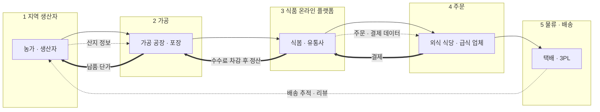

# 밸류체인 v0 — AI 초안 (검증 전)

> 프롬프트: `prompts.md` 1번 (과정 기본 체인 "지역 생산자 → 가공 → 식품 온라인 플랫폼 → 주문 → 물류·배송"을 그대로 넣어 받은 첫 초안)
> **검증 전 초안이라 틀린 곳이 있음** — 무엇이 틀렸는지는 `analysis.md` '검증' 절, 고친 결과는 `valuechain_v1.md`

## 단계별 근거 (원페이지 어느 칸인지)

| 단계 | 초안 내용 | 원페이지 근거 |
|---|---|---|
| 1 지역 생산자 | 농가 · 생산자 | 3 주요 제품 (도매시장 농산물) — 도매시장 · 중도매인이 빠짐 |
| 2 가공 | 가공 공장 · 포장 | 근거 없음 (제조는 매출 0.7%) |
| 3 식품 온라인 플랫폼 | 식봄 · 유통사 | 2 어떻게 전달 — "유통사"는 이름 없는 상자 |
| 4 주문 | 외식 식당 · 급식 업체 | 2 누구에게 |
| 5 물류 · 배송 | 택배 · 3PL | 근거 없음 (CJ는 자체 물류센터) |
