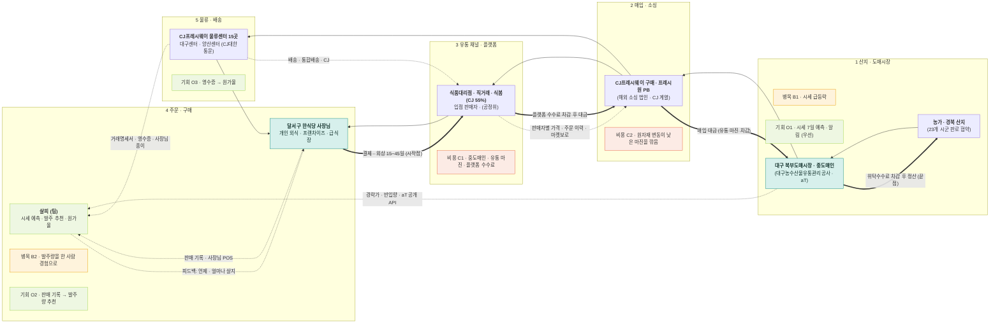

# 밸류체인 맵 v1 — CJ프레시웨이 · 대시보드 데이터 흐름도 (데이터 · 서비스 트랙)

> v0을 `../onepager.md` · `../sources.md` 와 대조해 고친 판 (무엇을 왜 고쳤는지는 `analysis.md`)
> 표기: `-->` 상품 · 거래 흐름 · `==>` 돈(라벨은 차감 이름, 금액 · 비율은 출처가 없어 쓰지 않음) · `-.->` 데이터(데이터 이름 · 보유자)
> 색: 틸 = 팀 자산 · 주황 테두리 = 병목 · 코랄 테두리 = 비용 · 라임 = 기회 · 발표용 그림은 `valuechain_v1.html`

## 네 층 표 (단계별 근거)

| 층 | 1 산지 · 도매시장 🟦 | 2 매입 · 소싱 | 3 유통 채널 · 플랫폼 | 4 주문 · 구매 🟦 | 5 물류 · 배송 |
|---|---|---|---|---|---|
| ① 활동 | 중도매인에게서 도매시장 농산물 매입 [출처 31] · 경북 판로 협약 [출처 41] | PB 프레시원 약 900종 · 해외 소싱 [출처 10][출처 5] | 식봄 오픈마켓 주문 · AI 가격비교 [출처 13][출처 26] | 식당 발주 · 결제 [출처 10] | 양산 동부 물류센터 · 통합배송 [출처 4][출처 10] |
| ② 이해관계자 | **농가 · 대구 북부도매시장 중도매인** (대구농수산물유통관리공사 · aT) [출처 34][출처 46] | **CJ프레시웨이 구매** (해외 법인 3곳 · CJ 계열) [출처 48][출처 2] | **식품대리점 · 직거래 · 식봄(마켓보로) · 입점 판매자** (공정위) [출처 48][출처 14][출처 6] | **달서구 한식당 사장님 · 프랜차이즈 · 급식장** (살피) [출처 3][출처 47] | **CJ프레시웨이 물류센터 — 대구센터 · 양산센터** (CJ대한통운) [출처 48][출처 2] |
| ③ 돈 (←) | 정산 — 끝점 · 위탁수수료 차감 [I] | 매입 대금 · 유통 마진 · 국내매입 90.3% / 수입 9.7% [출처 48] | 대리점 · 직거래 외상(15일 · 45일 이내 회수) [출처 48] · 플랫폼 판매 수수료 [I] | 결제 — 시작점 [I] | 배송비 (별도 여부 [U]) |
| ④ 데이터 이름 | 경락가 · 반입량 | 품목별 매입액 · 국내 / 수입 [출처 48] | 판매자별 가격 · 검색 · 주문 이력 | 판매 기록 · 발주 판단 | 배송 · 통합배송 건수 · 거래명세서 |
| ④ 생성 지점 | 경매 (대구 북부도매시장) | CJ 구매 | 식봄 앱 | 식당 POS · 사장님 | 물류센터 · 배송 |
| ④ 보유자 | aT · 도매시장법인 (공개 API) [출처 46] | CJ프레시웨이 (비공개 [U]) | 마켓보로 · CJ [출처 26] | **사장님 — 공급사로 안 돌아감 (단절)** [I] | CJ (배송) · **사장님 종이 영수증 (단절)** [I] |
| 신호 | 공급 · 가격 신호 | 재고 신호 [U] | 가격 신호 | **수요 신호** | 물류 · 원가 신호 |
| 마커 | 병목 B1 · 기회 O1(우선) | 비용 C2 | 비용 C1 | 병목 B2 · 기회 O2 | 기회 O3 |

- 피드백 화살표: 식당 판매 기록 · 영수증 → 살피 → "언제 · 얼마나 살지" → 주문 단계 (지금은 비어 있던 경로를 살피가 이음) [출처 47][I]
- 데이터 단절 마커: 4단계 판매 기록 · 5단계 영수증은 사장님 손에만 있고, 1단계 공개 시세는 식당 발주로 오지 않음(공공 시세 참고 6.8%) [출처 45]
